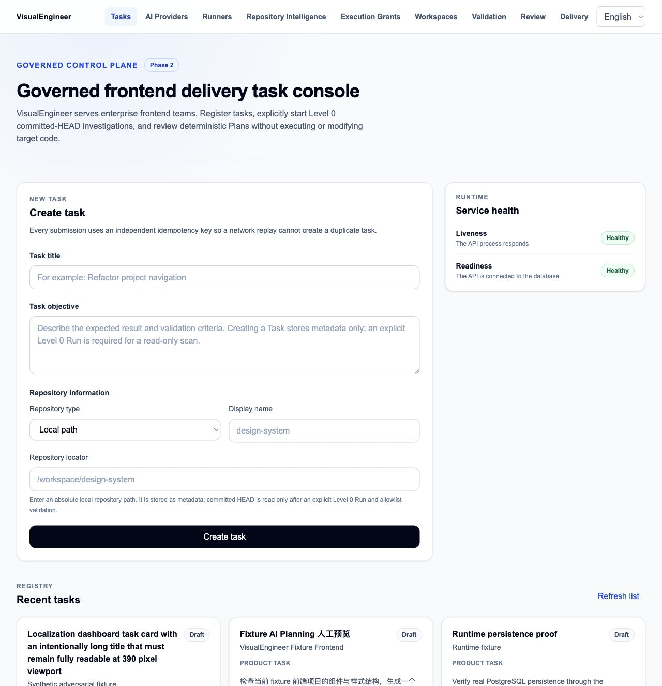
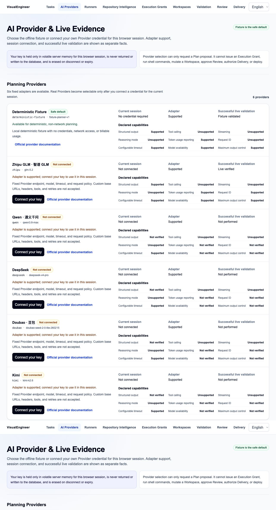
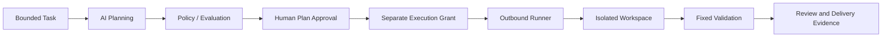
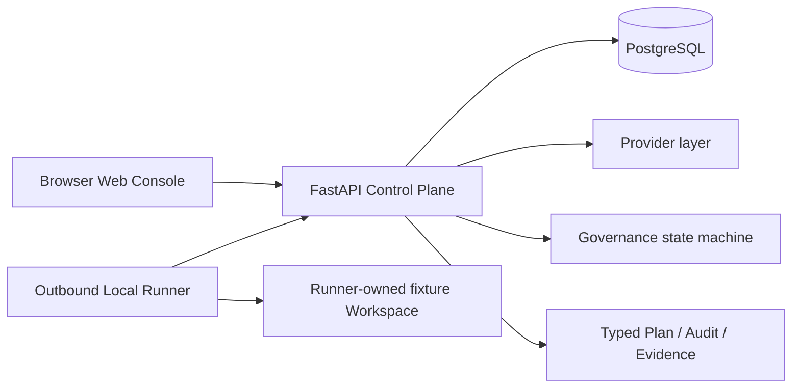
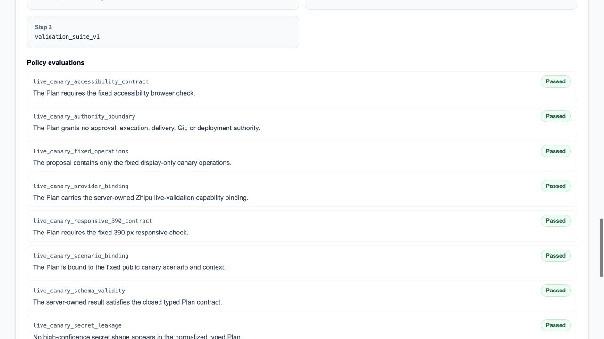
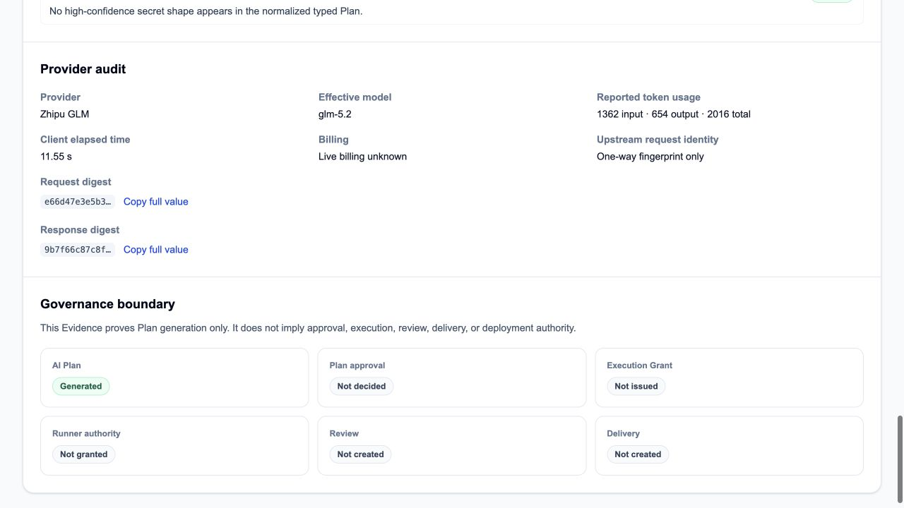
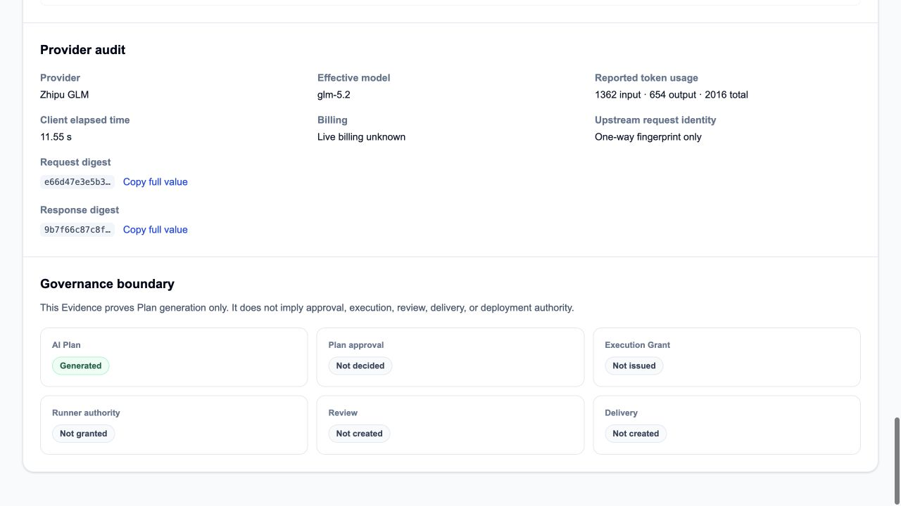
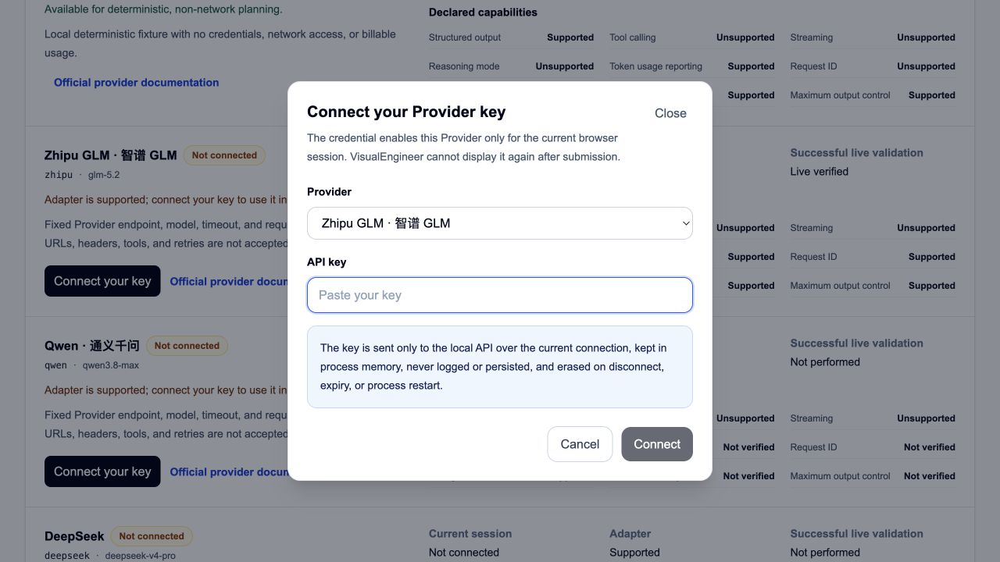

# VisualEngineer

[简体中文](README.md) | English

[Architecture](docs/architecture/overview.md) · [Portfolio evidence assets](docs/portfolio/evidence-assets.md) · [Security](SECURITY.md)

VisualEngineer is a local, single-user governed AI design-engineering and delivery system. It turns a bounded frontend objective into a typed plan and keeps planning separate from approval, execution, review, delivery, and evidence.

AI can propose a plan. It cannot obtain execution authority by proposing one.

## Why VisualEngineer

An LLM-plus-tools workflow can blur provider access, execution permission, and proof of what happened. That makes ambiguous provider outcomes hard to handle and expands the risk of a request or credential becoming an unreviewed side effect.

VisualEngineer keeps the boundaries explicit:

- governed planning and policy evaluation;
- human Plan Approval and a separate Execution Grant;
- an outbound, isolated Runner with typed operations;
- database-backed lifecycle and immutable evidence; and
- session-scoped user BYOK with no fallback to an owner credential.

The result is a reviewable delivery path, not a general-purpose autonomous coding agent.

## Demo preview

<p align="center">
  
  
</p>

The screenshots are sealed, portfolio-safe captures from the merged-main Web Console. They do not represent a new request or a deployment. See [evidence asset provenance](docs/portfolio/evidence-assets.md).

## Core workflow



`AI Plan != Execution Authority`. A provider result does not create approval, an Execution Grant, Runner authority, review, delivery, Git, or deployment authority.

## Architecture

VisualEngineer is a process-oriented monorepo, not a microservice fleet.



The Web Console does not access PostgreSQL, a workspace, Git, Docker, or credentials directly. The API owns the durable governance state; the Runner polls outward for closed job schemas and is isolated from the browser and database. A provider proposes typed output through the API; it cannot call the Runner or issue an Execution Grant.

For boundary detail, see [Architecture Overview](docs/architecture/overview.md) and [Security Boundaries](docs/security/security-boundaries.md).

## Governed AI provider layer

| Provider state               | What it means                                                                                                                                                                     |
| ---------------------------- | --------------------------------------------------------------------------------------------------------------------------------------------------------------------------------- |
| Deterministic Fixture        | Default deterministic, non-network demo path. No credential or billable provider usage.                                                                                           |
| Zhipu / GLM-5.2              | Adapter supported and live validated by one sealed governed invocation. A new user session still requires its own credential.                                                     |
| Qwen, DeepSeek, Doubao, Kimi | Adapters are shown in the Console; live validation was not performed. Do not interpret adapter availability as live validation.                                                   |
| BYOK                         | A user credential is held only in volatile server memory for the current browser session, is not returned or persisted, and is cleared on disconnect, expiry, or process restart. |

Fixture or mock evidence is not live provider evidence. The Console also makes this distinction visible.

## Real live validation

The sealed main baseline contains one successful governed Zhipu / GLM-5.2 invocation:

- correlation: `3a9c354f7a58`
- lifecycle: `succeeded`
- usage: 1,362 input + 654 output = 2,016 total tokens
- provider latency: 11,543 ms; client total: 11,553 ms (about 11.55 s)
- billing: `live_billing_unknown`

This generated a typed Plan with three fixed proposal operations and eight passed policy evaluations. It did not create an approval, Execution Grant, Runner authority, review, or delivery record.

<p align="center">
  
  
</p>

## Failure engineering story

The live-validation history is intentionally not rewritten into a simple success narrative:

1. Attempts 1 and 2 ended as `outcome_unknown` after transport ambiguity.
2. The transport path gained safe observability and response-path diagnosis.
3. Attempt 3 ended as `outcome_unknown` with `provider_response_decoding_failed`.
4. A narrow Zhipu content-encoding and decoded-response compatibility repair preserved the existing authority boundary.
5. Attempt 4, correlation `3a9c354f7a58`, succeeded.

There was no automatic retry, no false success, and no mutation of the three earlier immutable records. Ambiguous post-dispatch outcomes remain `outcome_unknown` because the system cannot truthfully infer whether the external provider acted.

## Security and governance

- Plan Approval is separate from an Execution Grant.
- A provider cannot directly invoke Runner authority.
- Ordinary user paths cannot consume an owner canary credential; BYOK does not fall back to an owner quota.
- Provider invocations use a durable `prepared → dispatching → terminal` lifecycle, with immutable terminal records.
- There is no automatic retry after ambiguous dispatch.
- Evidence is a safe projection: no raw key, full upstream request ID, raw provider request/response, or database credential is placed in portfolio material.
- The Runner works against a private, fixture-only workspace boundary; source repositories remain outside the normal Web/API path.

<p align="center">
  
  
</p>

## Engineering validation

Final sealed main baseline: commit `9615bde962c7dfeb73f9644573066d74d2d837ec`, tree `8f4b95fd1257a830e0aec3792063110d2690e730`, Alembic head `20260810_0017`.

| Gate                    | Run           | Result             |
| ----------------------- | ------------- | ------------------ |
| CI / Fast               | `31581978015` | attempt 1, success |
| CI / Heavy Verification | `31581978289` | attempt 1, success |

The repository includes migration, API, Web, contract, formatting, type, Playwright, workspace-chaos, security, and deterministic-evaluation gates. The final CI result is the validation claim here; this documentation change does not reinterpret older evidence as a fresh run.

## Local demo

Prerequisites and exact version pins are in the repository (`Node.js 24.18.0`, pnpm 11.14.0, Python 3.12.13, Docker Compose v2).

```sh
make bootstrap
make platform-up
```

Open the Web Console at `http://127.0.0.1:3000`. This starts the fixture demo path; it creates local synthetic fixtures and a local Runner bootstrap token. It is not a read-only inspection command.

For the smallest deterministic planning walkthrough, follow [Fixture AI Planning Demo](docs/runbooks/fixture-ai-planning-demo.md). No real provider key is needed for Fixture.

Real-provider BYOK is deliberately separate. It requires a user-provided, current-session credential and is not part of the default demo. Do not run `make zhipu-live-canary-run` without a separately authorized external request.

## Repository structure

- `apps/web` — Next.js Web Console.
- `apps/api` — FastAPI Control Plane, governance, providers, and migrations.
- `packages/runner-protocol` — versioned typed job contracts.
- `apps/runner` — outbound Local Runner and closed executors.
- `docs/architecture`, `docs/security`, `docs/evidence` — architecture, boundaries, and retained verification records.
- `fixtures` — deterministic, synthetic demo inputs.

## Current scope and limitations

VisualEngineer is a local, single-user development system. It is not a production deployment and makes no customer, adoption, QPS, revenue, or performance-improvement claim. Fixture-only paths cover mutation, validation, and local delivery proof. The one live validation is Zhipu / GLM-5.2 only; other adapters are not live validated. BYOK is volatile, session-scoped handling, not a multi-tenant commercial secret vault. Remote Git, pull requests, merge, release, deployment, public hosting, authentication, tenancy, and production SRE controls are out of scope.

## Contributing and license

See [CONTRIBUTING.md](CONTRIBUTING.md). No open-source license has been granted; see [License Decision](docs/publication/license-decision.md).
