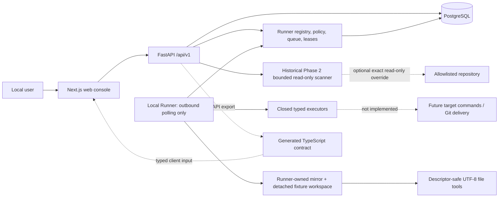

# VisualEngineer

VisualEngineer is a governed AI design-engineering and delivery system for
enterprise frontend teams. Its intended V1 destination is a human-approved
system that can understand a bounded frontend request, investigate an
authorized repository, propose a plan, work inside an isolated workspace,
validate in a browser, recover from failure, and prepare an evidence-backed
pull request.

It is not a general-purpose autonomous coding system. V1 is constrained to
three delivery packages:

1. **Design Implementation:** new pages, components, and explicit design
   requirements.
2. **Design-System Migration:** bounded token, component, and brand-rule
   migration.
3. **Frontend Quality Remediation:** responsive, visual, accessibility, and
   explicitly identified frontend-quality repairs.

The product separates a governed **VisualEngineer Core** from a customer
**Deployment Pack**. Core owns the implemented Task/Run, committed-snapshot,
deterministic-plan, approval, and audit boundaries. A Deployment Pack supplies
a repository profile, customer constraints, allowed future validation,
design-system context, acceptance criteria, test strategy, and project
playbook. Phase 4 implements one fixture-only isolated-workspace path. Phase 5
adds system-owned fixed validation, immutable multi-step Suites, and governed
final review. Phase 6 adds a separately approved, fixture-only local branch
and commit lifecycle. The Phase 7 first slice adds model-neutral governed AI
planning through a deterministic fake Provider; real model calls and every
remote delivery integration remain future capabilities.

## Current state

Local `main` at `9c282e91a42a87ea553171d5aa55a0f77564bb14`
contains the completed Phase 0-6 first and second slices. The active candidate
is **Phase 7 First Vertical Slice — Governed AI Planning with Deterministic
Provider** on `codex/phase-7-governed-ai-planning-first-slice`. It is a
fixture-only implementation candidate pending independent focused review; it
is not a real-Provider authorization, production claim, seal, or main
integration.

A local user can independently approve a narrow Execution Grant, prepare an
exact detached workspace, use closed UTF-8 file tools, inspect bounded
status/diff/checkpoints, roll back to baseline, and discard it. Plan approval
never creates or approves an Execution Grant.

The implemented target is:

- a responsive Next.js task console;
- a versioned FastAPI Task, Run, Snapshot, Plan, decision, and audit API;
- PostgreSQL persistence and Alembic schema history;
- immutable committed-HEAD snapshots with bounded dirty-path metadata;
- a fixed-command, no-shell repository scanner with allowlist, secret,
  symlink, submodule, LFS, byte-budget, and timeout controls;
- deterministic plan generation and Foundation policy validation;
- a closed model-neutral planning Provider protocol, deterministic fixture
  replay, versioned Prompt registry, bounded redacted context manifest,
  structured AI Plan schema, attempt Trace, synthetic non-billable usage/cost,
  and system-owned deterministic Eval evidence;
- a revision-bound AI Plan request state machine with stale fencing,
  idempotent replay, concurrent one-winner human approve/reject, and an
  authority-free handoff to the existing governed Plan chain;
- revision, stale-version, idempotency, and concurrent final-decision guards;
- a pure versioned Runner Protocol with immutable canonical-hash Permission
  Envelopes;
- PostgreSQL Runner registry, durable Job queue, `SKIP LOCKED` claim, Attempts,
  leases, cancellation, retries, reaper, fencing, and typed events;
- an independent outbound non-root Runner with repository-free diagnostic/wait
  Jobs and one fixture-only opaque Repository Handle;
- immutable, independently decided Execution Grants bound to an approved
  Plan/Snapshot/revision with `sandbox/**`, denied sensitive paths, budgets,
  no network, no shell, no source write, and no Git delivery;
- a no-source-Git snapshot adapter that validates bounded loose/packed Git
  objects, computes only the authorized revision's commit/tree/blob closure,
  and materializes it into new Runner-owned loose-object inodes with no
  alternates, plus detached exact-revision workspaces in dedicated volumes;
- short-lived PostgreSQL-backed Side-effect Permits for prepare, create/
  replace, rollback, and discard, with bounded Grant revocation semantics;
- signed Runner-local Workspace ownership and pending/completed discard
  evidence, authenticated registry state, exact root-inode reconciliation,
  and fail-closed recovery/quarantine rather than unproven deletion;
- descriptor-rooted list/read/create/compare-and-swap replace, fixed Git
  status/diff, immutable checkpoints, baseline rollback, and exact discard;
- two immutable fixture Validation Profiles and one
  `fixture-integrity-suite-v1:v1` Suite with no user-supplied step, command,
  argv, cwd, environment, package, or URL;
- separately approved validation-only Grants bound to an exact Workspace
  Checkpoint/revision and fixed run, timeout, CPU, memory, PID, file-descriptor,
  output, artifact, and expiry budgets;
- a disposable Runner validation sandbox with bounded no-follow input copy,
  Linux Landlock filesystem confinement, seccomp network denial, monotonic
  timeout/cancel, process-group cleanup, and exact sandbox removal;
- immutable bounded Validation Run/step/evidence records that preserve the
  canonical Workspace for passing, failing, timed-out, and cancelled runs;
- immutable Suite Run/ordered-step/aggregate-result records with serial
  dispatch, fail-fast, per-step and combined budgets, cancellation, one-Run
  lineage-bound Grant consumption, and a fresh-Grant retry that reuses
  successful Evidence without redispatch;
- trusted Suite success reconstruction from the exact catalog, child
  Run/Job/Attempt/Lease/Grant/Permit/Evidence chain, recomputed digests, and
  ordered PostgreSQL-enforced aggregate references;
- immutable versioned final Review Packages with ordered Evidence Manifests,
  exact revision/Workspace/Checkpoint tree+diff/Suite+Profile/policy/Grant
  lineage, freshness generations, permanent transaction-bound invalidation,
  one expected-generation and keyed immutable local-user Review Decision,
  sequenced append-only AuditEvents, frozen Critical/High/blocking-Medium
  counts, and a PostgreSQL-recomputed deterministic Release Readiness Verdict;
- explicit false Git and deployment authorization throughout Review Package,
  Decision, readiness, API, database, and browser surfaces;
- separate immutable local Delivery Authorization/Decision, dual-bound
  Side-effect Permit, fixed Runner Git plumbing, and one durable fixture-only
  local branch/commit proof with source and remote invariance;
- browser Runner registry, dispatch, Job detail, progress, result, cancellation,
  offline/retry evidence, and Timeline;
- generated OpenAPI-to-TypeScript contract artifacts;
- adversarial security evaluation and deterministic quality checks;
- Docker Compose for local development;
- optional API-only read-only repository mounts for synthetic and Customer 0
  investigation;
- CI definitions that mirror local commands;
- concrete product, architecture, permission, security, and evaluation
  documents.

Explicitly not implemented: any real model SDK, network model call, API key,
model-specific evaluation or billing, general shell, arbitrary
target-repository commands, package lifecycle or installation, any
CreativeDeploy workspace/write, source-repository write, binary/delete/rename
tools, remote push/PR/tag/deploy delivery, remote CI evidence, automated visual
comparison or repair, authentication, multi-tenancy, public hosting, or
production deployment.

CreativeDeploy is internal Customer 0 and Design Partner 0. It is not in scope
for this Phase 7 slice: it must not be accessed, mounted, read, written,
tested, built, or used as verification evidence. Historical Phase 2 documents
describe a separately authorized read-only path, but that does not authorize
this branch. CreativeDeploy is not an external enterprise customer and
provides no time-saving, adoption, production-impact, or production-deployment
evidence.

## Architecture



FastAPI OpenAPI is the HTTP contract source. The browser never accesses the
database or target repository directly. Runner Protocol v1 is shared as a pure
Pydantic package. The Phase 3 base platform has no repository mount. Phase 4's
fixture profile gives only Runner one exact read-only source mount plus
dedicated mirror, workspace, and registry volumes; API, Web, and PostgreSQL get
none. Phase 2's optional read-only scanner override remains historical and
separate.

## Local development

Prerequisites and exact command behavior are defined by the project manifests
and Makefile. The verified local sequence is:

```sh
make bootstrap
make platform-up
```

Local endpoints are the web console at `http://localhost:3000`, API
documentation at `http://localhost:8000/docs`, liveness at
`http://localhost:8000/health/live`, and readiness at
`http://localhost:8000/health/ready`. The Runner console is
`http://localhost:3000/runners`. Startup generates an ignored high-entropy
local Bootstrap Token without printing it and waits for the Runner to become
online. Phase 4 browser pages are `/repositories`, `/execution-grants`,
`/workspaces`, and `/workspaces/{id}`. The Phase 5 fixture-only validation flow
is `/validations`; governed final review is `/reviews`.

Stop project services with:

```sh
make down
```

Do not commit `.env.runner.local` or any `.env`.

## Testing and contracts

Use the narrow commands while developing and the aggregate command before a
checkpoint:

```sh
make format-check
make lint
make typecheck
make test
make build
make contracts-check
make migration-check
make phase4-findings-check
make source-invariance-check
make workspace-security-check
make workspace-security-repair-check
make security-check
make eval
make e2e
make runner-smoke
make workspace-smoke
make workspace-chaos-check
make verify
```

Backend integration and migration tests must use PostgreSQL. Playwright must
exercise the real web/API/database stack rather than a mocked API. Contract
generation must be repeatable and leave no diff. See the current final local
gate evidence before treating any check as passed:
[`docs/evidence/phase-4-final-integration-gate-verification.md`](docs/evidence/phase-4-final-integration-gate-verification.md).

To run the internal Customer 0 case after all synthetic gates pass:

```sh
CUSTOMER0_REPOSITORY_PATH="$HOME/Developer/CreativeDeploy" \
  make customer0-readonly-case
```

This mount is API-only and read-only. The command creates or reuses the
idempotent Customer 0 Task and Run, creates a committed-HEAD Snapshot and
deterministic Plan, submits it, and stops at `awaiting_plan_approval`. It never
approves, rejects, installs, builds, tests, or modifies CreativeDeploy.

## Docker

The local target uses `docker compose` services for `db`, `api`, `web`, and
`runner`, with explicit health checks and a migration step. Runner is
non-root, root-filesystem-read-only, capability-free, CPU/memory/PID/FD
bounded, has no published port, and joins only the internal `runner-control`
network. The fixture override mounts one exact synthetic source read-only only
into Runner and adds separate credential, mirror, workspace, and registry
volumes. Intended commands are:

```sh
docker compose config
docker compose build
make up
make logs
make down
```

An image build is not a production deployment. Production migration,
credentials, networking, backups, and observability remain future work.

## Security limits

This project remains local-only and single-user. It must not be exposed
publicly. A locator alone grants no access: Level 0 reads require a canonical
allowlisted local Git root, and target repositories remain read-only.
Repository text is untrusted data, not an instruction source. Human plan
approval is a durable governance decision, not execution permission. A
separate immutable Grant authorizes only the exact fixture Workspace scope.
Every mutating operation additionally requires a current, attempt-bound,
single-use Side-effect Permit immediately before the filesystem mutation.
Unprovable Workspace ownership enters recovery/quarantine and is not deleted.
Descriptor confinement is deliberately conservative but does not claim
hostile multi-tenant syscall isolation. Local bearer tokens are not a
production identity scheme. Never add real secrets. Read
[`SECURITY.md`](SECURITY.md) before integration work.

## Documentation

- [Product contract](docs/product/product-contract.md)
- [V1 boundaries](docs/product/v1-boundaries.md)
- [System overview](docs/architecture/system-overview.md)
- [Isolated workspaces](docs/architecture/isolated-workspaces.md)
- [Runner Protocol v1](docs/architecture/runner-protocol.md)
- [Run state machine](docs/architecture/state-machine.md)
- [Data model](docs/architecture/data-model.md)
- [Tool permissions](docs/architecture/tool-permissions.md)
- [Threat model](docs/security/threat-model-v0.md)
- [Runner threat model](docs/security/runner-threat-model.md)
- [Workspace threat model](docs/security/workspace-threat-model.md)
- [Phase 4 ExecPlan](docs/exec-plans/phase-4-isolated-workspace-tools.md)
- [Phase 3 ExecPlan](docs/exec-plans/phase-3-browser-orchestrated-local-runner.md)
- [Phase 2 ExecPlan](docs/exec-plans/phase-2-readonly-repository-intelligence.md)
- [Foundation ExecPlan](docs/exec-plans/phase-0-1-foundation.md)
- [Project status](docs/status/project-status.md)
- [Environment audit](docs/evidence/phase-0-1-environment-audit.md)
- [Phase 2 verification evidence](docs/evidence/phase-2-verification.md)
- [Phase 3 verification evidence](docs/evidence/phase-3-verification.md)
- [Phase 4 verification evidence](docs/evidence/phase-4-verification.md)
- [Phase 4 independent security audit](docs/security/audits/phase-4-workspace-security-audit.md)
- [Phase 4 security repair ExecPlan](docs/exec-plans/phase-4-security-repair.md)
- [Phase 4 security repair evidence](docs/evidence/phase-4-security-repair-verification.md)
- [Phase 4 independent security re-audit](docs/security/audits/phase-4-security-reaudit.md)
- [Phase 4 Security Remediation Round 2 ExecPlan](docs/exec-plans/phase-4-security-remediation-2.md)
- [Phase 4 Security Remediation Round 2 evidence](docs/evidence/phase-4-security-remediation-2-verification.md)
- [Phase 4 Final Integration Gate ExecPlan](docs/exec-plans/phase-4-final-integration-gate.md)
- [Phase 4 Final Integration Gate evidence](docs/evidence/phase-4-final-integration-gate-verification.md)
- [Local development runbook](docs/runbooks/local-development.md)
- [Local Runner runbook](docs/runbooks/local-runner.md)
- [Runner recovery runbook](docs/runbooks/runner-recovery.md)
- [Workspace lifecycle runbook](docs/runbooks/workspace-lifecycle.md)
- [Workspace recovery runbook](docs/runbooks/workspace-recovery.md)
- [Customer 0 read-only runbook](docs/runbooks/customer0-readonly-investigation.md)
- [CreativeDeploy Customer 0 evidence](docs/deployment-cases/creative-deploy/phase-2-readonly-evidence.md)
- [Evaluation strategy](docs/evals/eval-strategy-v0.md)
