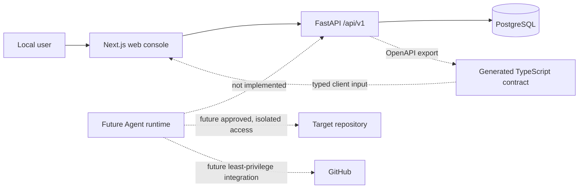

# VisualEngineer

VisualEngineer is a governed AI design-engineering and delivery system for
enterprise frontend teams. Its intended V1 destination is a human-approved
system that can understand a bounded frontend request, investigate an
authorized repository, propose a plan, work inside an isolated workspace,
validate in a browser, recover from failure, and prepare an evidence-backed
pull request.

It is not a general-purpose autonomous coding system. V1 is constrained to
three delivery packages:

1. **Design Implementation:** new pages, components, and explicit design
   requirements.
2. **Design-System Migration:** bounded token, component, and brand-rule
   migration.
3. **Frontend Quality Remediation:** responsive, visual, accessibility, and
   explicitly identified frontend-quality repairs.

The product separates a governed **VisualEngineer Core** from a customer
**Deployment Pack**. Core will own Task/Run orchestration, approvals, safe
workspaces, tool policy, validation, trace/eval, evidence, and recovery
boundaries. A Deployment Pack will supply a repository profile, customer
constraints, allowed commands, design-system context, acceptance criteria,
test strategy, and project playbook. These future runtime capabilities are not
implemented by the current Foundation.

## Current state

The repository has implemented and locally verified the Phase 0 + Phase 1
Foundation vertical slice. The web/API/PostgreSQL stack, migrations, generated
contract, Docker images, unit/integration tests, and real browser smoke flow
pass the complete local pre-commit matrix. Remote GitHub Actions have not run.

The Foundation target is:

- a responsive Next.js task console;
- a versioned FastAPI task API;
- PostgreSQL persistence and Alembic schema history;
- generated OpenAPI-to-TypeScript contract artifacts;
- deterministic quality and smoke checks;
- Docker Compose for local development;
- CI definitions that mirror local commands;
- concrete product, architecture, permission, security, and evaluation
  documents.

Explicitly not implemented in this phase: an Agent runtime, LLM calls,
repository-reading tools, code-writing tools, isolated target worktrees,
approval execution, GitHub PR creation, remote CI evidence, automated visual
comparison or repair, authentication, public hosting, or production deployment.

CreativeDeploy is Customer 0 and Design Partner 0: the first real internal
usage target for shaping the Deployment Pack. Only a bounded read-only survey
has occurred. CreativeDeploy is not an external enterprise customer and
provides no adoption or outcome evidence yet.

## Architecture



FastAPI OpenAPI is the HTTP contract source. The browser never accesses the
database or target repository directly. A repository locator stored on a task
is metadata only.

## Local development

Prerequisites and exact command behavior are defined by the project manifests
and Makefile. The verified local sequence is:

```sh
cp .env.example .env
make bootstrap
make db-up
make migrate
make up
```

Local endpoints are the web console at `http://localhost:3000`, API
documentation at `http://localhost:8000/docs`, liveness at
`http://localhost:8000/health/live`, and readiness at
`http://localhost:8000/health/ready`. Services are intentionally stopped after
verification; run `make up` to make these addresses available.

Stop project services with:

```sh
make down
```

Do not commit the local `.env`.

## Testing and contracts

Use the narrow commands while developing and the aggregate command before a
checkpoint:

```sh
make format-check
make lint
make typecheck
make test
make contracts
make build
make e2e
make verify
```

Backend integration and migration tests must use PostgreSQL. Playwright must
exercise the real web/API/database stack rather than a mocked API. Contract
generation must be repeatable and leave no diff. See the current evidence
before treating any check as passed:
[`docs/evidence/phase-0-1-verification.md`](docs/evidence/phase-0-1-verification.md).

## Docker

The Foundation target uses `docker compose` services for `db`, `api`, and
`web`, with explicit health checks and a dedicated migration step. Intended
commands are:

```sh
docker compose config
docker compose build
make up
make logs
make down
```

An image build is not a production deployment. Production migration,
credentials, networking, backups, and observability remain future work.

## Security limits

This project is local-only and single-user at Foundation stage. It must not be
exposed publicly. It does not authorize access to a repository from a locator,
and external repositories remain read-only unless a future isolated operation
receives explicit human approval. Never add real secrets. Read
[`SECURITY.md`](SECURITY.md) before integration work.

## Documentation

- [Product contract](docs/product/product-contract.md)
- [V1 boundaries](docs/product/v1-boundaries.md)
- [System overview](docs/architecture/system-overview.md)
- [Run state machine](docs/architecture/state-machine.md)
- [Data model](docs/architecture/data-model.md)
- [Tool permissions](docs/architecture/tool-permissions.md)
- [Threat model](docs/security/threat-model-v0.md)
- [Foundation ExecPlan](docs/exec-plans/phase-0-1-foundation.md)
- [Project status](docs/status/project-status.md)
- [Environment audit](docs/evidence/phase-0-1-environment-audit.md)
- [Verification evidence](docs/evidence/phase-0-1-verification.md)
- [Local development runbook](docs/runbooks/local-development.md)
- [CreativeDeploy read-only survey](docs/integrations/creative-deploy-readonly-survey.md)
- [Evaluation strategy](docs/evals/eval-strategy-v0.md)
