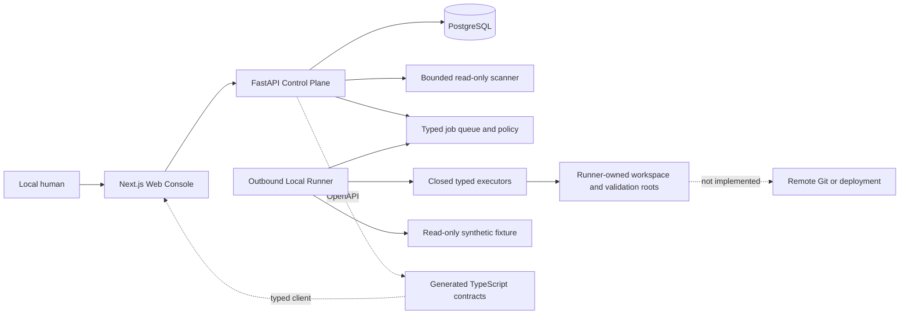

# VisualEngineer

[简体中文](README.zh-CN.md) ·
[Architecture](docs/architecture/overview.md) ·
[Quick Start](#quick-start) ·
[Security](SECURITY.md) ·
[Contributing](CONTRIBUTING.md)

VisualEngineer is a governed design-engineering and delivery system for
enterprise frontend teams. It turns a bounded frontend objective into
reviewable repository facts, a human-decided plan, fixture-only isolated work,
deterministic validation evidence, final review, and an explicitly authorized
local delivery proof.

It is not a general-purpose autonomous coding agent. The implemented system is
local and single-user, uses synthetic fixtures for every write or validation
path, has no real model connection, and cannot push, open a pull request, tag,
merge, deploy, or modify a source repository.

## The problem it addresses

Enterprise frontend delivery often mixes intent, repository access,
implementation authority, test evidence, review, and release permission. That
makes it difficult to prove what a tool observed, what a person approved, and
which side effect was actually authorized.

VisualEngineer keeps those facts separate. Repository content is untrusted
input. A plan approval is only a decision record. Workspace mutation, final
review, local delivery, and each side effect require distinct, narrowly bound
authority.

## Implemented capabilities

- Bounded Task and Run lifecycle with immutable committed-`HEAD` snapshots.
- Fixed, no-shell repository intelligence with sensitive-path, secret,
  symlink, submodule, LFS, binary, count, byte, and timeout controls.
- Deterministic policy planning and a model-neutral governed AI planning
  protocol backed only by `DeterministicFixtureProvider`.
- Versioned prompts, bounded redacted context, typed plan output, replayable
  traces, synthetic non-billable usage, and system-owned deterministic evals.
- Human plan approval that creates no execution, review, delivery, Git, or
  deployment authority.
- An outbound Local Runner with an opaque repository handle, typed jobs,
  leases, cancellation, retry, and fenced attempts.
- Fixture-only isolated UTF-8 workspace tools rooted in a Runner-owned copy.
- Fixed fixture validation profiles and an immutable multi-step suite in a
  disposable Linux sandbox with filesystem and network restrictions.
- Immutable final review packages, freshness invalidation, human review
  decisions, and deterministic readiness verdicts.
- A separately approved, digest-confirmed, fixture-only local branch and
  commit lifecycle. Remote Git remains unavailable.
- Responsive `en-US` and `zh-CN` web-console experiences with explicit raw
  protocol diagnostics where translation would hide operational facts.

See [Product Contract](docs/product/product-contract.md) and
[V1 Boundaries](docs/product/v1-boundaries.md) for the precise implemented and
reserved scope.

## End-to-end governance workflow

1. A user creates a bounded frontend Task and starts a read-only Run.
2. The Control Plane records an immutable snapshot from allowlisted committed
   Git objects; dirty and untracked content is not read.
3. Deterministic policy or the deterministic fake Provider proposes a plan.
4. A human approves or rejects that exact plan version. Approval grants no
   execution authority.
5. A separate Execution Grant can authorize fixture-only workspace operations.
6. Separate validation authority can run only fixed system-owned profiles.
7. A Review Package binds the exact evidence and receives a separate human
   decision and readiness verdict.
8. A separate Delivery Authorization plus exact manifest confirmation can
   authorize one local fixture commit.
9. Remote push, pull request, tag, merge, release, and deployment remain
   unavailable.

The authority distinctions are summarized in
[Architecture Overview](docs/architecture/overview.md#authority-is-not-transitive).

## Architecture



The Web never accesses PostgreSQL, Git, Docker, a workspace, or credentials.
The API owns governance state but executes no Runner job. The Runner polls
outbound, receives closed job schemas, and knows fixture paths that the API and
Web do not. PostgreSQL and service checks independently enforce important
state and authority invariants.

Detailed diagrams and boundary descriptions are in
[docs/architecture/overview.md](docs/architecture/overview.md) and
[docs/architecture/system-overview.md](docs/architecture/system-overview.md).

## Technology stack

- Web: Next.js 16, React 19, strict TypeScript, Tailwind CSS, next-intl,
  Vitest, Testing Library, Playwright, and axe.
- API: Python 3.12, FastAPI, Pydantic v2, SQLAlchemy 2, Alembic, psycopg,
  pytest, Ruff, mypy, and coverage.
- Runner protocol: versioned Pydantic models shared without API or executor
  dependencies.
- Persistence: PostgreSQL 17 with additive Alembic migrations.
- Tooling: Node.js `24.18.0`, pnpm `11.14.0`, Python `3.12.13`, uv, Make,
  Docker, and Docker Compose.
- Contracts: FastAPI OpenAPI is authoritative; TypeScript output is generated.

## Quick Start

### Prerequisites

- Git and Make.
- Docker Desktop or another Docker Engine with Compose v2.
- Node.js `24.18.0` and Corepack/pnpm `11.14.0`.
- Python `3.12.13` and uv.

The pinned versions are recorded in `.python-version`, `package.json`,
`pnpm-lock.yaml`, `uv.lock`, and the Dockerfiles. Local verification has been
performed on Apple Silicon macOS with Docker Desktop. The workflows target
GitHub-hosted Linux, but no remote GitHub Actions run is claimed by this
repository state.

### Bootstrap and start

```sh
make bootstrap
make platform-up
```

`make bootstrap` installs only lockfile-resolved project dependencies.
`make platform-up` creates the synthetic fixture, generates an ignored local
Runner bootstrap token without printing it, builds the local services, applies
the current migration, waits for health checks, and seeds the fixture-only
workspace path.

No real Provider key is required or accepted by the ordinary planning path.
The separate local Zhipu live-canary CLI remains disabled behind independent
review, exact preflight, and one-process authorization; do not create or enter
a real credential for normal setup.

Open:

- Web Console: `http://127.0.0.1:3000`
- API docs: `http://127.0.0.1:8000/docs`
- Liveness: `http://127.0.0.1:8000/health/live`
- Readiness: `http://127.0.0.1:8000/health/ready`

The interface-language selector switches between English and Simplified
Chinese. Raw IDs, digests, states, and error codes remain visible for
operational diagnosis.

For an isolated, deterministic AI planning walkthrough, follow
[Fixture AI Planning Demo](docs/runbooks/fixture-ai-planning-demo.md). It uses
only generated local fixtures, performs no network model call, and stops before
any approval unless the human operator explicitly decides the plan.

The pre-live canary contract can be inspected without reading a Provider
credential:

```sh
make zhipu-live-canary-preflight
```

Do not run `make zhipu-live-canary-run` until the candidate has passed an
independent security review and a later task explicitly authorizes one local
external request. Zhipu and every other real Provider remain disabled in the
normal product registry.

### Migration-only development path

```sh
make db-up
make migrate
```

### Diagnose and stop

```sh
make platform-logs
make platform-down
```

`make platform-down` removes project containers and the network while
preserving named development data. If ports `3000`, `8000`, `5432`, or `55433`
are already occupied, set the corresponding published-port variables and keep
`WEB_ORIGIN` and `NEXT_PUBLIC_API_BASE_URL` consistent; do not terminate an
unrelated process.

`.env.example` documents safe local configuration. A real `.env`, generated
`.env.runner.local`, logs, databases, traces, browser artifacts, caches, and
build outputs must remain untracked.

## Tests and quality gates

The repository provides narrow gates and one aggregate gate:

```sh
make contracts-check
make format-check
make lint
make typecheck
make test
make build
make migration-check
make source-invariance-check
make security-check
make eval
make e2e
make workspace-chaos-check
make verify
```

`make verify` is intentionally expensive. It combines contracts, formatting,
lint, types, unit/integration tests, production Web build, Compose validation,
migration checks, source invariance, workspace and security checks, real-stack
Playwright, chaos, deterministic evals, and final whitespace validation.

Historical local evidence is retained under `docs/evidence/`. A workflow file
or old evidence is not proof that a new revision passed remotely or locally;
only a command run against that revision with exit code `0` is a current pass.

## Security model

The core rules are deny by default, exact immutable bindings, least authority,
human decisions at distinct boundaries, no shell, no unreviewed network, no
source write, and no secret logging. See [SECURITY.md](SECURITY.md),
[Security Boundaries](docs/security/security-boundaries.md), and the Runner and
Workspace threat models.

Do not report vulnerabilities, credentials, customer data, or exploit details
in a public issue. The private reporting route is intentionally marked as a
pre-publication owner decision because no public security address exists.

## Current limitations

- Local, single-user development posture; no authentication, tenancy, CSRF
  design, public hardening, backup operations, or production SRE model.
- No enabled real Provider product path or completed live validation. The
  reviewed Zhipu canary entrypoint is pre-live, local-only, and not activation.
- All mutation, validation, and local delivery capabilities are synthetic
  fixture-only.
- No arbitrary shell, target repository commands, package installation, or
  real customer workspace.
- No remote clone/fetch/push, pull request, merge, tag, release, GitHub Pages,
  public hosting, or deployment.
- No production-customer, performance, time-saving, or adoption claims.

## Roadmap

Future work requires separate design, authorization, and independent security
review for:

- authenticated users, organizations, roles, and production operations;
- isolated real-Provider credentials, egress policy, observability, and
  Provider-specific evals;
- non-fixture repository workspaces and closed target validation commands;
- controlled browser and visual evidence;
- remote Git and pull-request authority distinct from review readiness; and
- backup, recovery, rate/resource limits, incident response, and deployment.

These are roadmap items, not available capabilities.

## Contributing

See [CONTRIBUTING.md](CONTRIBUTING.md). Public contribution intake is not open
until the repository owner chooses a license, security contact, and public
collaboration policy. A Code of Conduct is therefore not added yet.

## License

No open-source license has been granted. The repository owner must make an
explicit decision before converting the repository to Public. The decision
record compares Apache-2.0, MIT, and retaining all rights in
[License Decision](docs/publication/license-decision.md). Apache-2.0 is the
current recommendation, not an adopted license.
