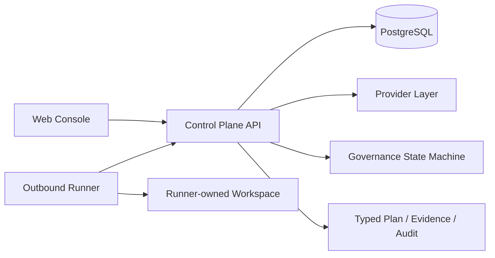

# VisualEngineer

简体中文 | [English](README.en.md)

> 面向前端团队的受治理 AI 设计工程与交付系统，将 AI 规划、授权、执行、验证与证据审计保持为彼此独立的工程边界。

[面试作品集 PDF](docs/portfolio/VisualEngineer_Interview_Portfolio.pdf) · [本地 Fixture Demo](docs/runbooks/fixture-ai-planning-demo.md) · [English README](README.en.md) · [架构说明](docs/architecture/overview.md) · [Evidence 资产](docs/portfolio/evidence-assets.md) · [安全边界](docs/security/security-boundaries.md)

VisualEngineer 是一个本地、单用户的工程系统。它把前端交付目标转化为类型化 Plan，同时明确隔离 Plan Approval、Execution Grant、Runner 执行、验证、审查、交付和 Evidence。AI 可以提出方案，但不能因为提出方案就自动获得修改仓库、执行命令或交付结果的权限。

## 为什么做 VisualEngineer

常见的 LLM + Tools 工作流容易把三件事混在一起：Provider 能否生成建议、系统是否允许执行、结果是否有可审计证据。这样既会放大凭据和副作用风险，也会在外部请求结果不明确时制造不真实的“成功”。

VisualEngineer 把这些边界变成显式的状态、类型和持久化约束。它不是普通的 LLM wrapper，也不是通用自主编码 Agent；它是一条可复核的前端工程交付路径。

## 核心原则

- `Plan Approval != Execution Grant`：批准 Plan 不等于授予执行权限。
- Provider 只能提出类型化 Plan，不能直接获得 Runner authority。
- Runner 只接受封闭的类型化操作，不向模型开放任意 shell。
- Workspace 与源仓库隔离，并绑定精确 revision、Grant、lease 与 fencing。
- Validation、Review、Delivery 与 AI Planning 分离，任何阶段都不能被前一阶段隐式授权。
- Evidence-first：完成声明必须能回到 Git SHA/tree、CI、测试、浏览器、数据库或 Provider lifecycle 证据。

## 核心工作流

```mermaid
flowchart LR
    T["Task"] --> RI["Repository Intelligence"]
    RI --> P["AI Planning"]
    P --> E["Policy / Evaluation"]
    E --> A["Plan Approval"]
    A --> G["Execution Grant"]
    G --> R["Runner"]
    R --> W["Isolated Workspace"]
    W --> V["Validation"]
    V --> RV["Review"]
    RV --> D["Delivery"]
    D --> AU["Evidence / Audit"]
```



Provider 输出进入受控生命周期和策略评估；只有独立批准的 Execution Grant 才能让合格的类型化任务到达 Runner。验证结果、Review 和 Delivery 仍是后续独立事实。

## 架构



- **Web Console**：浏览器优先的任务、Provider、授权、验证和 Evidence 界面。
- **Control Plane API**：拥有治理状态机、策略、权限转换和安全投影。
- **PostgreSQL**：持久化生命周期、不可变量和并发竞争边界。
- **Provider Layer**：把受支持 Provider 的输出规范化为类型化 Plan，不拥有执行权限。
- **Runner / Workspace**：Runner 出站轮询封闭任务，在隔离 Workspace 中执行精确操作。
- **Evidence / Audit**：记录适合审查的事实，不公开原始密钥、完整上游 ID 或私有 Provider 载荷。

详见 [Architecture Overview](docs/architecture/overview.md) 与 [Security Boundaries](docs/security/security-boundaries.md)。

## Provider 与真实 Live Validation

VisualEngineer 分别呈现三种事实：Adapter 是否受支持、当前会话是否连接凭据、是否完成过成功的 Live Validation。三者不能互相替代。

| Provider 状态                | 准确含义                                                                                                   |
| ---------------------------- | ---------------------------------------------------------------------------------------------------------- |
| Deterministic Fixture        | 默认的确定性、无网络、无凭据、不可计费演示路径。                                                           |
| Zhipu / GLM-5.2              | Adapter 已支持，并由一次封存的受治理调用完成 Live Validation；新会话仍需用户自己的凭据。                   |
| Qwen、DeepSeek、Doubao、Kimi | Console 中可见 Adapter，但未完成 Live Validation。                                                         |
| BYOK                         | 用户凭据只保存在当前浏览器会话对应的易失性服务端内存中，不返回、不持久化，并在断开、过期或进程重启时清除。 |

已封存的成功调用：

- correlation：`3a9c354f7a58`
- lifecycle：`succeeded`
- model：Zhipu / `glm-5.2`
- usage：1,362 input + 654 output = 2,016 tokens
- Provider latency：11,543 ms；client total：11,553 ms
- billing：`live_billing_unknown`

该调用生成了包含 3 个固定 proposal operations 的类型化 Plan，并通过 8 条策略评估；它没有创建 Approval、Execution Grant、Runner authority、Review 或 Delivery。


## Failure Engineering

真实调用历史没有被改写成一条简单的成功故事：

1. Attempt 1–2 在 dispatch 后出现结果歧义，持久状态保留为 `outcome_unknown`。
2. 系统补充受控 transport observability，并对 response path 进行诊断。
3. Attempt 3 明确分类为 `provider_response_decoding_failed`。
4. 仅修复 Zhipu content-encoding / decoded-response compatibility，不扩大权限或重试策略。
5. Attempt 4 成功，历史 3 次记录保持不可变。

`outcome_unknown` 很重要：外部请求可能已经产生计费或副作用时，系统不能凭本地异常推断失败，也不能自动重试制造第二次受控事件。

## BYOK 与 Owner-Key Isolation

普通用户路径不会回退使用维护者 Provider credential 或额度。BYOK 是 session-scoped 的易失性处理，不是商业级多租户 Secret Vault。

Fixture 仍是最安全、最可复现的默认演示路径，不需要真实 Provider Key，也不会产生 Provider 请求或费用。

## Runner / Workspace 治理

- Execution Grant 绑定独立批准的范围、Runner、Workspace、操作与期限。
- Workspace 基于精确 revision 隔离创建，不把真实源仓库暴露给 Web/API。
- lease、attempt identity 与 fencing 防止过期或竞争中的 Runner 继续产生副作用。
- Runner 仅支持封闭类型化操作；不存在模型直达任意 shell、远程 Git、合并、发布或部署的路径。
- Validation Profile 与 Evidence 记录用于证明结果，不把“命令运行过”当作交付完成。

## PostgreSQL 并发案例

真实 PostgreSQL 回归曾稳定复现 `40P01`：嵌套提交让部分绑定的 Validation Run / Runner Job 提前可见，两个事务形成 transaction-id 等待环。

修复没有使用盲目 retry、sleep 或放宽断言，而是纠正原子事务边界：Runner Job、子 Validation Run、Permission Envelope 与最终绑定在同一外层事务中发布。修复后受控竞争 10 / 10 通过，且没有未绑定子记录。详见 [验证证据](docs/evidence/validation-run-grant-deadlock-deterministic-regression-verification.md)。

## Evidence / Validation

VisualEngineer 将声明与证据类型显式对应：

- Git SHA/tree 确立被审查的精确仓库状态；
- Fast / Heavy CI、测试与类型检查回答代码和集成问题；
- 浏览器 Evidence 验证真实 UI、响应式与可访问性；
- PostgreSQL Evidence 验证迁移、持久化与并发不变量；
- Provider lifecycle 保留 `prepared → dispatching → terminal` 及外部不确定性；
- 不可变失败历史防止把旧失败追溯改写为成功；
- Secret-negative Evidence 只保留安全投影，不发布 Key、原始流量、账户或账单材料。

最终封存的产品 main 基线：commit `9615bde962c7dfeb73f9644573066d74d2d837ec`，tree `8f4b95fd1257a830e0aec3792063110d2690e730`，Alembic head `20260810_0017`。

| Gate                    | Run           | Result             |
| ----------------------- | ------------- | ------------------ |
| CI / Fast               | `31581978015` | attempt 1, success |
| CI / Heavy Verification | `31581978289` | attempt 1, success |

## 本地演示

仓库固定使用 Node.js 24.18.0、pnpm 11.14.0、Python 3.12.13 和 Docker Compose v2。默认 Fixture 演示：

```sh
make bootstrap
make platform-up
```

打开 `http://127.0.0.1:3000`。该命令会创建本地 synthetic fixtures 和 Runner bootstrap token，并启动本地服务，不是只读操作。

最小可复现路径见 [Fixture AI Planning Demo](docs/runbooks/fixture-ai-planning-demo.md)。默认演示不需要真实 Provider Key。未经单独外部请求授权，不要运行 `make zhipu-live-canary-run`。

## 当前范围与限制

主要开发已完成；当前项目是本地、单用户的工程证明与系统，不是 production deployment。它不声称真实客户、收入、用户量、QPS 或性能提升。Fixture-only 路径覆盖本地 mutation、validation 与 delivery proof；唯一完成 Live Validation 的真实 Provider 是 Zhipu / GLM-5.2，其他 Adapter 不得表述为已完成 Live Validation。

BYOK 不是商业多租户密钥库。Remote Git、PR、merge、release、deployment、public hosting、authentication、tenancy 与 production SRE 控制不在当前产品范围内。

## AI 辅助工程说明

我负责产品定义、架构约束、风险决策、验收标准和最终验证；ChatGPT + Codex 加速仓库调研、实现、测试、文档以及 Git / CI 工作。项目价值来自可解释、可验证的工程闭环，而不是“所有代码均手写”。

## Contributing 与 License

参见 [CONTRIBUTING.md](CONTRIBUTING.md)。当前仓库未授予开源许可证，详见 [License Decision](docs/publication/license-decision.md)。Repository 公开后应准确描述为“公开可查看源代码”，而不是自动视为 OSI open source。
