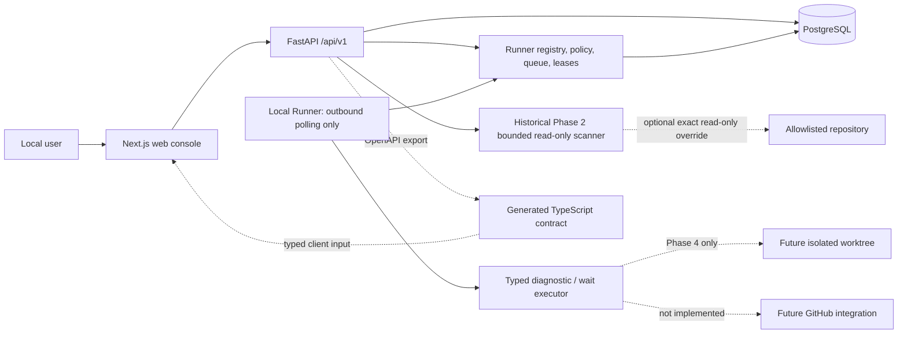

# VisualEngineer

VisualEngineer is a governed AI design-engineering and delivery system for
enterprise frontend teams. Its intended V1 destination is a human-approved
system that can understand a bounded frontend request, investigate an
authorized repository, propose a plan, work inside an isolated workspace,
validate in a browser, recover from failure, and prepare an evidence-backed
pull request.

It is not a general-purpose autonomous coding system. V1 is constrained to
three delivery packages:

1. **Design Implementation:** new pages, components, and explicit design
   requirements.
2. **Design-System Migration:** bounded token, component, and brand-rule
   migration.
3. **Frontend Quality Remediation:** responsive, visual, accessibility, and
   explicitly identified frontend-quality repairs.

The product separates a governed **VisualEngineer Core** from a customer
**Deployment Pack**. Core owns the implemented Task/Run, committed-snapshot,
deterministic-plan, approval, and audit boundaries. A Deployment Pack supplies
a repository profile, customer constraints, allowed future validation,
design-system context, acceptance criteria, test strategy, and project
playbook. Isolated workspaces, executable tools, recovery, and delivery
integrations remain future capabilities.

## Current state

The repository implements the Phase 0 + Phase 1 Foundation, Phase 2 governed
read-only repository intelligence, and the Phase 3 browser-orchestrated Local
Runner foundation. A local user can complete the Phase 2 planning flow or open
`/runners`, review a registered Runner, dispatch one of two repository-free
typed Jobs, observe fenced attempts and durable events, and cancel a controlled
wait. Plan approval never dispatches a Runner Job.

The implemented target is:

- a responsive Next.js task console;
- a versioned FastAPI Task, Run, Snapshot, Plan, decision, and audit API;
- PostgreSQL persistence and Alembic schema history;
- immutable committed-HEAD snapshots with bounded dirty-path metadata;
- a fixed-command, no-shell repository scanner with allowlist, secret,
  symlink, submodule, LFS, byte-budget, and timeout controls;
- deterministic plan generation and Foundation policy validation;
- revision, stale-version, idempotency, and concurrent final-decision guards;
- a pure versioned Runner Protocol with immutable canonical-hash Permission
  Envelopes;
- PostgreSQL Runner registry, durable Job queue, `SKIP LOCKED` claim, Attempts,
  leases, cancellation, retries, reaper, fencing, and typed events;
- an independent outbound non-root Runner that executes only System Diagnostic
  and Controlled Wait with no repository, shell, worktree, Git, or public
  network;
- browser Runner registry, dispatch, Job detail, progress, result, cancellation,
  offline/retry evidence, and Timeline;
- generated OpenAPI-to-TypeScript contract artifacts;
- adversarial security evaluation and deterministic quality checks;
- Docker Compose for local development;
- optional API-only read-only repository mounts for synthetic and Customer 0
  investigation;
- CI definitions that mirror local commands;
- concrete product, architecture, permission, security, and evaluation
  documents.

Explicitly not implemented: OpenAI Agents SDK, LLM calls, Agent Trace,
code-writing or general shell tools, target-repository access or command
execution, isolated target worktrees, approval-triggered execution, GitHub PR
creation, remote CI evidence, automated visual comparison or repair,
authentication, public hosting, or production deployment.

CreativeDeploy is internal Customer 0 and Design Partner 0: the first real
usage target for shaping the Deployment Pack. Its Phase 2 path is an API-only
read-only bind mount. Repository intelligence is based on committed `HEAD`;
dirty and untracked contents are not read. CreativeDeploy is not an external
enterprise customer and provides no time-saving, adoption, production-impact,
or production-deployment evidence.

## Architecture



FastAPI OpenAPI is the HTTP contract source. The browser never accesses the
database or target repository directly. Runner Protocol v1 is shared as a pure
Pydantic package. The Phase 3 base platform has no repository mount; the
Runner has only the API-facing internal network and its credential volume.
Phase 2's optional read-only scanner override remains historical and separate.

## Local development

Prerequisites and exact command behavior are defined by the project manifests
and Makefile. The verified local sequence is:

```sh
make bootstrap
make platform-up
```

Local endpoints are the web console at `http://localhost:3000`, API
documentation at `http://localhost:8000/docs`, liveness at
`http://localhost:8000/health/live`, and readiness at
`http://localhost:8000/health/ready`. The Runner console is
`http://localhost:3000/runners`. Startup generates an ignored high-entropy
local Bootstrap Token without printing it and waits for the Runner to become
online.

Stop project services with:

```sh
make down
```

Do not commit `.env.runner.local` or any `.env`.

## Testing and contracts

Use the narrow commands while developing and the aggregate command before a
checkpoint:

```sh
make format-check
make lint
make typecheck
make test
make build
make contracts-check
make migration-check
make security-check
make eval
make e2e
make runner-smoke
make runner-chaos-check
make verify
```

Backend integration and migration tests must use PostgreSQL. Playwright must
exercise the real web/API/database stack rather than a mocked API. Contract
generation must be repeatable and leave no diff. See the current evidence
before treating any check as passed:
[`docs/evidence/phase-3-verification.md`](docs/evidence/phase-3-verification.md).

To run the internal Customer 0 case after all synthetic gates pass:

```sh
CUSTOMER0_REPOSITORY_PATH="$HOME/Developer/CreativeDeploy" \
  make customer0-readonly-case
```

This mount is API-only and read-only. The command creates or reuses the
idempotent Customer 0 Task and Run, creates a committed-HEAD Snapshot and
deterministic Plan, submits it, and stops at `awaiting_plan_approval`. It never
approves, rejects, installs, builds, tests, or modifies CreativeDeploy.

## Docker

The local target uses `docker compose` services for `db`, `api`, `web`, and
`runner`, with explicit health checks and a migration step. Runner is
non-root, read-only, capability-free, has no published port, and joins only
the internal `runner-control` network. Intended commands are:

```sh
docker compose config
docker compose build
make up
make logs
make down
```

An image build is not a production deployment. Production migration,
credentials, networking, backups, and observability remain future work.

## Security limits

This project remains local-only and single-user. It must not be exposed
publicly. A locator alone grants no access: Level 0 reads require a canonical
allowlisted local Git root, and target repositories remain read-only.
Repository text is untrusted data, not an instruction source. Human plan
approval is a durable governance decision, not Runner dispatch permission.
Phase 3 Envelopes are server-derived and fixed to no repository, no shell, and
Control-Plane-only network. Local bearer tokens are not a production identity
scheme. Never add real secrets. Read
[`SECURITY.md`](SECURITY.md) before integration work.

## Documentation

- [Product contract](docs/product/product-contract.md)
- [V1 boundaries](docs/product/v1-boundaries.md)
- [System overview](docs/architecture/system-overview.md)
- [Runner Protocol v1](docs/architecture/runner-protocol.md)
- [Run state machine](docs/architecture/state-machine.md)
- [Data model](docs/architecture/data-model.md)
- [Tool permissions](docs/architecture/tool-permissions.md)
- [Threat model](docs/security/threat-model-v0.md)
- [Runner threat model](docs/security/runner-threat-model.md)
- [Phase 3 ExecPlan](docs/exec-plans/phase-3-browser-orchestrated-local-runner.md)
- [Phase 2 ExecPlan](docs/exec-plans/phase-2-readonly-repository-intelligence.md)
- [Foundation ExecPlan](docs/exec-plans/phase-0-1-foundation.md)
- [Project status](docs/status/project-status.md)
- [Environment audit](docs/evidence/phase-0-1-environment-audit.md)
- [Phase 2 verification evidence](docs/evidence/phase-2-verification.md)
- [Phase 3 verification evidence](docs/evidence/phase-3-verification.md)
- [Local development runbook](docs/runbooks/local-development.md)
- [Local Runner runbook](docs/runbooks/local-runner.md)
- [Runner recovery runbook](docs/runbooks/runner-recovery.md)
- [Customer 0 read-only runbook](docs/runbooks/customer0-readonly-investigation.md)
- [CreativeDeploy Customer 0 evidence](docs/deployment-cases/creative-deploy/phase-2-readonly-evidence.md)
- [Evaluation strategy](docs/evals/eval-strategy-v0.md)
