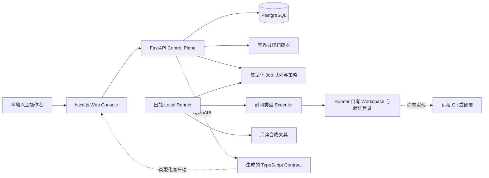

# VisualEngineer

[English](README.md) ·
[架构说明](docs/architecture/overview.md) ·
[快速开始](#快速开始) ·
[安全策略](SECURITY.md) ·
[贡献指南](CONTRIBUTING.md)

VisualEngineer 是面向企业前端团队的受治理设计工程与交付系统。它把一个边界明确的前端目标，转化为可复核的仓库事实、由人决定的计划、仅限合成夹具的隔离工作、确定性验证证据、最终审查，以及经过单独授权的本地交付证明。

它不是通用的自主编程 Agent。当前实现是本地单用户系统；所有写入和验证路径都只针对合成夹具；没有接入真实模型，也不能 push、创建 PR、打 tag、合并、部署或修改源仓库。

## 它解决什么问题

企业前端交付经常把需求意图、仓库访问、实施权限、测试证据、审查结论和发布权限混在一起，因而很难回答三个关键问题：系统实际看到了什么、人批准了什么、某个副作用究竟由哪份权限授权。

VisualEngineer 将这些事实拆开。仓库内容始终是不可信输入；计划批准只是决策记录；Workspace 写入、最终审查、本地交付以及每次副作用，都需要独立、精确且不可传递的权限。

## 已实现能力

- 有界的 Task/Run 生命周期，以及基于已提交 `HEAD` 的不可变快照。
- 固定参数、无 shell 的仓库智能，覆盖敏感路径、Secret、符号链接、submodule、LFS、二进制、数量、字节和超时边界。
- 确定性策略计划，以及只由 `DeterministicFixtureProvider` 驱动的模型中立 AI 计划协议。
- 版本化 Prompt、受限且脱敏的上下文、类型化计划输出、可回放 Trace、合成且不计费的用量，以及系统自有确定性 Eval。
- 人工计划批准不会产生执行、审查、交付、Git 或部署权限。
- 采用不透明仓库句柄、类型化 Job、Lease、取消、重试和 fencing 的出站 Local Runner。
- 仅限合成夹具、位于 Runner 自有副本中的隔离 UTF-8 Workspace 工具。
- 固定的夹具验证 Profile 与不可变多步骤 Suite；Linux 下使用一次性沙箱和文件系统、网络限制。
- 不可变 Review Package、freshness 失效、人工 Review Decision 与确定性 readiness verdict。
- 经过单独批准并确认 manifest digest 的夹具本地 branch/commit 生命周期；远程 Git 仍不可用。
- 响应式 `en-US` / `zh-CN` Web Console；为避免翻译掩盖真实诊断，原始协议值仍然可见。

精确的实现范围与保留边界见[产品契约](docs/product/product-contract.md)和 [V1 边界](docs/product/v1-boundaries.md)。

## 端到端治理流程

1. 用户创建边界明确的前端 Task，并启动只读 Run。
2. Control Plane 仅从 allowlist 内已提交的 Git 对象生成不可变 Snapshot；不会读取 dirty 或 untracked 内容。
3. 确定性策略或 deterministic fake Provider 提出计划。
4. 人对该精确计划版本批准或拒绝；批准本身不授予执行权限。
5. 独立的 Execution Grant 才能授权仅限夹具的 Workspace 操作。
6. 独立的 validation 权限只能运行系统预定义 Profile。
7. Review Package 绑定精确证据，并接受另一份人工决策和 readiness verdict。
8. 独立 Delivery Authorization 加上精确 manifest 确认，才能授权一次夹具本地提交。
9. 远程 push、PR、tag、merge、release 和 deploy 均不可用。

各类权限的区别见[架构概览中的“权限不可传递”](docs/architecture/overview.md#authority-is-not-transitive)。

## 架构



Web 不直接访问 PostgreSQL、Git、Docker、Workspace 或凭据。API 管理治理状态，但不执行 Runner Job。Runner 只出站轮询、只接受封闭 Job schema，并掌握 API/Web 不知道的夹具路径。关键状态与权限不变量由服务层和 PostgreSQL 双重约束。

更完整的边界和图示见[架构概览](docs/architecture/overview.md)与[系统总览](docs/architecture/system-overview.md)。

## 技术栈

- Web：Next.js 16、React 19、严格 TypeScript、Tailwind CSS、next-intl、Vitest、Testing Library、Playwright、axe。
- API：Python 3.12、FastAPI、Pydantic v2、SQLAlchemy 2、Alembic、psycopg、pytest、Ruff、mypy、coverage。
- Runner Protocol：独立于 API 和 Executor 的版本化 Pydantic 模型。
- 持久化：PostgreSQL 17 与增量 Alembic migration。
- 工具链：Node.js `24.18.0`、pnpm `11.14.0`、Python `3.12.13`、uv、Make、Docker、Docker Compose。
- Contract：FastAPI OpenAPI 为唯一事实源，TypeScript 类型由其生成。

## 快速开始

### 前置软件

- Git 与 Make。
- Docker Desktop，或带 Compose v2 的 Docker Engine。
- Node.js `24.18.0` 与 Corepack/pnpm `11.14.0`。
- Python `3.12.13` 与 uv。

固定版本记录在 `.python-version`、`package.json`、`pnpm-lock.yaml`、`uv.lock` 和 Dockerfile 中。本地验证环境包括 Apple Silicon macOS 与 Docker Desktop。GitHub workflow 面向托管 Linux Runner，但当前仓库状态不声称任何远程 GitHub Actions 已通过。

### 安装并启动

```sh
make bootstrap
make platform-up
```

`make bootstrap` 只安装 lockfile 已解析的项目依赖。`make platform-up` 会创建合成夹具、生成不会打印到终端且被 Git 忽略的 Runner bootstrap token、构建本地服务、应用当前 migration、等待健康检查，并写入夹具 Workspace 的演示数据。

当前计划路径不需要、也不接受真实 Provider Key；请不要为本地启动创建任何真实模型凭据。

访问地址：

- Web Console：`http://127.0.0.1:3000`
- API 文档：`http://127.0.0.1:8000/docs`
- Liveness：`http://127.0.0.1:8000/health/live`
- Readiness：`http://127.0.0.1:8000/health/ready`

顶部语言选择器可在英文和简体中文之间切换。ID、digest、state、error code 等原始运行值不会被翻译隐藏。

确定性 AI Planning 演示见[夹具 AI Planning 演示](docs/runbooks/fixture-ai-planning-demo.md)。该流程只使用本地生成的合成仓库，不发起模型网络请求；除非人工操作者主动决定，否则停在计划决策之前。

### 只启动数据库并迁移

```sh
make db-up
make migrate
```

### 诊断与停止

```sh
make platform-logs
make platform-down
```

`make platform-down` 会移除本项目的容器和网络，但保留命名开发数据。若 `3000`、`8000`、`5432` 或 `55433` 已被占用，请设置相应 published-port 变量，并同步调整 `WEB_ORIGIN` 与 `NEXT_PUBLIC_API_BASE_URL`；不要终止无关进程。

`.env.example` 只描述安全的本地配置。真实 `.env`、自动生成的 `.env.runner.local`、日志、数据库、trace、浏览器产物、缓存与构建输出都必须保持 untracked。

## 测试与质量门禁

仓库提供可单独运行的门禁和一个完整聚合门禁：

```sh
make contracts-check
make format-check
make lint
make typecheck
make test
make build
make migration-check
make source-invariance-check
make security-check
make eval
make e2e
make workspace-chaos-check
make verify
```

`make verify` 成本较高，聚合 contract、格式、lint、类型、单元/集成测试、Web production build、Compose 配置、migration、source invariance、Workspace 与安全检查、真实栈 Playwright、chaos、确定性 Eval 以及最终空白检查。

历史本地证据保存在 `docs/evidence/`。Workflow 文件或旧证据不能证明新 revision 已在本地或远程通过；只有针对该 revision 实际执行且 exit code 为 `0` 的命令，才是当前 PASS。

## 安全模型

核心原则包括默认拒绝、精确不可变绑定、最小权限、各治理边界由人分别决策、无 shell、无未审查网络、无源仓库写入，以及 Secret 不进入日志。详见 [SECURITY.md](SECURITY.md)、[安全边界](docs/security/security-boundaries.md)、Runner threat model 与 Workspace threat model。

不要在 public issue 中提交漏洞、凭据、客户数据或利用细节。仓库尚无公开安全邮箱；正式私密报告入口是转 Public 前必须由 owner 决定的事项。

## 当前限制

- 本地单用户开发形态；没有 authentication、multi-tenancy、CSRF 设计、公网加固、备份运维或生产 SRE 模型。
- 没有真实 Provider SDK、模型网络调用、API Key、真实计费或 Provider 专属 Eval。
- 所有写入、验证与本地交付都仅限合成夹具。
- 没有任意 shell、目标仓库命令、依赖安装或真实客户 Workspace。
- 没有远程 clone/fetch/push、PR、merge、tag、release、GitHub Pages、公网托管或部署。
- 不声称生产客户、性能数据、节省时间或外部采用成果。

## Roadmap

以下能力都需要单独设计、单独授权和独立安全审查：

- 用户/组织身份、角色权限与生产运维；
- 真实 Provider 的隔离凭据、出站网络策略、可观测性和专属 Eval；
- 非夹具仓库 Workspace 与封闭的目标验证命令；
- 受控浏览器与视觉证据；
- 与 review readiness 分离的远程 Git/PR 权限；
- 备份恢复、资源限制、事故响应与部署。

这些是未来方向，不是当前可用能力。

## 贡献

详见 [CONTRIBUTING.md](CONTRIBUTING.md)。在 owner 明确 License、安全联系渠道与公开协作规则之前，仓库不开放 public contribution intake，因此本轮不添加 Code of Conduct。

## License

当前没有授予开源许可。仓库转为 Public 前，owner 必须显式选择 License。[License 决策记录](docs/publication/license-decision.md)比较 Apache-2.0、MIT 与暂不公开授权。Apache-2.0 是当前推荐项，不代表已经采用。
