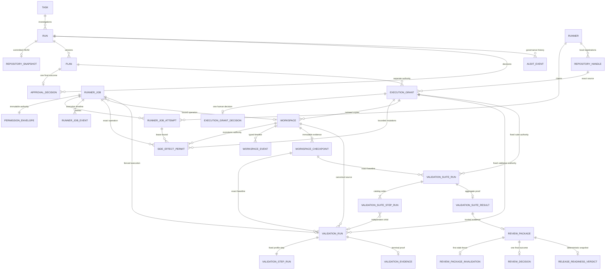

# Data Model

PostgreSQL and Alembic are authoritative for all implemented durable state.
Timestamps are timezone-aware UTC. API enums and database checks enforce the
Phase 2 planning, Phase 3 Runner, and Phase 4 workspace boundaries
independently.

## Task

Task stores a bounded title, objective, repository kind/display name/locator,
status, optimistic version, idempotency metadata, and timestamps. A locator is
untrusted metadata until an explicit Level 0 Snapshot request passes scanner
path policy. Task creation is transactionally idempotent.

## Run

| Field group | Invariant                                                          |
| ----------- | ------------------------------------------------------------------ |
| Identity    | UUID `id`, Task foreign key, stable UUID `trace_id`.               |
| Policy      | `permission_level = read_only`; `snapshot_mode = git_head`.        |
| State       | Closed Phase 2 status check and explicit service transition table. |
| Concurrency | Integer `version >= 1`; current Plan version is null or positive.  |
| Failure     | Stable bounded `error_code` and sanitized `error_message`.         |
| Idempotency | Unique optional key plus normalized request hash.                  |
| Time        | Created and updated UTC timestamps.                                |

## RepositorySnapshot

One successful Snapshot may belong to a Run. It stores:

- committed source revision and branch label;
- dirty boolean, total path count, and bounded relative-path/status metadata;
- scanner and scan-policy versions;
- deterministic SHA-256 fingerprint;
- tracked, selected, skipped, and selected-byte counts;
- structured stack, package manager, script names, test surfaces, and
  design-system signals;
- instruction path/hash/provenance/risk metadata;
- sanitized safety findings; and
- a bounded manifest with relative path, entry type, object/hash metadata, and
  skip reason.

It never stores the real host home path, selected source corpus, sensitive
value, dirty/untracked content, or followed symlink content. A unique Run
constraint prevents multiple successful rows. A PostgreSQL trigger rejects
both update and delete.

## Plan

Each Plan has a Run-scoped positive version and one of `draft`,
`awaiting_approval`, `approved`, `rejected`, or `superseded`. Database checks
fix `source` to `deterministic_policy`, limit delivery package, and force
`execution_available = false`.

Plan content includes the bound Snapshot fingerprint, objective and repository
summary, assumptions, proposed scope, non-goals, risks, acceptance criteria,
evidence requirements, stop conditions, typed validation-step JSON, required
future permission level, deterministic content hash, and UTC creation time.
Revision produces a new row rather than changing the prior content.

## ApprovalDecision

ApprovalDecision binds a Run and exact Plan to one `approve` or `reject`
outcome, local-user actor, optional bounded comment, request ID, and timestamp.
A unique Plan constraint permits one final row. A database check requires a
non-blank rejection reason. The service verifies that Run/Plan identities and
latest-version state agree before insertion.

## AuditEvent

AuditEvent stores Run identity, allowlisted event type, local-user/system actor,
request ID, sanitized structured metadata, and UTC creation time. Metadata
contains identifiers, hashes, counts, durations, booleans, and reason codes;
it excludes comments, source text, secrets, exception stacks, and absolute
repository paths.

AuditEvent is governance history, not a full Agent or tool trace.

## Runner

Runner stores UUID identity, display name, protocol/software versions,
normalized capabilities, a digest of its high-entropy token, closed
registered/online/offline/revoked state, last-seen/registration/revocation
time, optimistic version, and timestamps. No Bootstrap or Runner Token
plaintext column exists. Online/offline is derived from last seen and the
configured threshold.

## PermissionEnvelope

PermissionEnvelope is one-to-one with RunnerJob and stores version,
authorization source, allowed capabilities, literal repository access
(`none` or `isolated_workspace`), shell-false and Control-Plane-only network
policy, runtime/lease/retry/result budgets, issue/expiry timestamps, canonical
policy hash, and creation time. A database trigger rejects update and delete.

## RunnerJob and RunnerJobAttempt

RunnerJob stores the closed Job kind/state, immutable Envelope link,
`requested_by=local_user`, typed normalized parameters, active Attempt pointer,
attempt budget/count, optional immutable Execution Grant/Workspace/Repository
Handle/revision/policy bindings, typed sanitized result or stable error,
optimistic version, and timestamps.

RunnerJobAttempt stores Job/Runner identity, positive attempt number, random
Lease UUID, closed Attempt state, lease deadline, heartbeat/start/completion,
bounded error, and creation time. A partial unique index allows at most one
active leased/running Attempt for a Job.

## RunnerJobEvent

RunnerJobEvent stores nullable Runner/Job/Attempt links, a closed event type,
monotonic per-Job sequence, request ID, allowlisted bounded metadata, and
timestamp. It records current typed execution audit, not a future Agent Trace.
Heartbeats do not append an event on every poll.

## RepositoryHandle

RepositoryHandle stores Runner identity, an opaque locally configured handle,
display name, `git` kind, available/unavailable/revoked status, closed
`committed_head_read`/`isolated_workspace` capabilities, optional current
revision/branch, literal `source_status=unknown`, last verification, metadata
version, and timestamps. It neither stores a host path nor claims source dirty
metadata that would require working-tree Git execution.

## ExecutionGrant and ExecutionGrantDecision

ExecutionGrant is bound to an approved Plan, Run, Task, Repository Handle,
exact source revision, and Snapshot fingerprint. Immutable policy fields hold
the eight closed operations, controlled allowed/denied path lists, file/write/
diff budgets, Workspace TTL, literal network-none/shell-false/source-write-
false/Git-delivery-false authority, expiry, version, and canonical SHA-256
policy hash. Only status/decision timing may change through the service;
PostgreSQL rejects policy update/delete.

ExecutionGrantDecision records one approve/reject outcome, reason where
required, `local_user` actor, request ID, and timestamp. A unique Grant
constraint prevents competing decisions.

An approved Grant may transition through `revoke_requested` to effectively
`revoked`. `revocation_requested_at` records the transaction that first blocks
new Permits; `revoked_at` is present only after consumed Permits are terminal
or expired.

Phase 5 reuses this human-decision boundary with a mutually exclusive
validation scope. A validation Grant is bound to one existing Workspace and
immutable Checkpoint, the exact source revision, and a closed set containing
only `fixture-python-stdlib-v1:v1`. It fixes run count, timeout, CPU, memory,
PID, file-descriptor, output, artifact, and validity budgets. It cannot carry
Phase 4 file operations or authorize shell, network, source/canonical
Workspace writes, Git delivery, or deployment.

## SideEffectPermit

SideEffectPermit persists one consumed mutation authority. It binds Permit,
Grant, RunnerJob, Attempt, Lease, Workspace, Runner, Repository Handle,
revision, policy hash, operation, optional normalized relative path,
precondition/content/operation digests, monotonic Workspace sequence, issued/
expiry/consumed/terminal timestamps, and one of `consumed`, `completed`,
`failed`, `cancelled`, or `expired`.

The canonical operation digest includes the consumed state and
issued/consumed/expiry window so local authority-window changes fail
validation before mutation.

Database checks constrain digests, UUID bindings, deadlines, operation/path
shape, and terminal timestamps. Unique constraints prevent duplicate sequence
or idempotency identity. A PostgreSQL trigger rejects deletion, every authority
field update, and any transition out of a terminal state. Only state and
terminal time may change through the service.

## Workspace, WorkspaceEvent, and WorkspaceCheckpoint

Workspace binds Grant, Runner, Repository Handle, and exact revision. It stores
only state, workspace/initial/current fingerprints, changed-file and cumulative
write counts, an allowlisted created-path ledger, active Attempt, expiry,
timestamps, and sanitized error. No Runner filesystem path is stored.

WorkspaceEvent uses a monotonic per-Workspace sequence, closed event type,
request ID, optional Permit foreign key, strict bounded metadata, and
timestamp. WorkspaceCheckpoint is immutable and stores its optional Permit
foreign key, source revision, tree/diff fingerprints, bounded allowed relative
paths, count/size, and bounded textual diff evidence. Workspace states also
include visible `recovery_required` and `quarantined` terminal-like operator
conditions.

## ValidationRun, ValidationStepRun, and ValidationEvidence

ValidationRun binds one approved validation Grant to the exact Run, Plan,
revision, Workspace, Checkpoint, Profile/version, policy digest, Runner Job,
and idempotency key. Runner, Attempt, and Lease bindings are added only by the
fenced execution path. Its closed lifecycle distinguishes requested, queued,
claimed, running, cancel-requested, successful, failed, timed-out, cancelled,
and recovery-required outcomes.

ValidationStepRun records the single fixed step selected by the immutable
Profile. ValidationEvidence is one immutable bounded terminal record
containing safe fixed-argv display, timing/exit classification, bounded
redacted output, truncation/redaction counts, resource and artifact summary,
and process/sandbox cleanup proof. It also retains result-schema/step/revision/
policy identity, fixed argv/cwd/environment digests, Permit sequence/digest
and fencing token, artifact-manifest digest, full execution-envelope digest,
and evidence digest. Neither table accepts raw environment, user command,
host cwd/path, or credentials. Unique bindings prevent replay from creating a
second step or evidence row.

## ValidationSuiteRun, ValidationSuiteStepRun, and ValidationSuiteResult

ValidationSuiteRun binds a source-owned Suite ID/version and policy digest to
the exact Run, Plan, approved revision, sealed Workspace Checkpoint,
Suite-scoped Execution Grant, idempotency key, total timeout/output budgets,
and explicit root/source/attempt retry lineage. The Grant policy separately
stores the immutable Suite-definition digest, root/source bindings, attempt
number, and allowed Suite Run count of exactly one. A unique Grant-to-Suite
binding and unique root/attempt pair make Grant consumption and linear retry
authority durable. ValidationSuiteStepRun materializes only the catalogued
order and fixed Profile references. Each dispatched step points to an
independent ValidationRun and therefore to its own Runner Job, Attempt, Lease,
Permit, result, and immutable Evidence. A reused successful step points to its
original immutable Evidence and consumes zero retry output.

ValidationSuiteResult is the single immutable aggregate verdict. It records
the exact Suite/root/Run/Grant/definition/revision/Checkpoint/policy/attempt
and budget bindings, ordered Evidence/Profile/Runner references, timing,
output/redaction/truncation consumption, zero-artifact summary, cleanup and
source/canonical-Workspace invariance, and Audit references. The Control Plane
reconstructs successful references from locked child execution records and
recomputed Evidence digests. Database checks and triggers close state values,
enforce unique order/idempotency/lineage attempts, reject null/foreign/
duplicate/reordered proof, protect immutable authority and terminal rows, and
prevent a successful aggregate whose steps or budget are inconsistent.

## Relationships

## ReviewPackage, ReviewDecision, and ReleaseReadinessVerdict

ReviewPackage is one immutable digest-addressed final-review input. It binds a
latest successful ValidationSuiteResult to the exact Run, Plan, source
revision, Repository Handle, Workspace, Checkpoint/fingerprint, Suite Run, and
Suite Result/aggregate digest. Its versioned Evidence Manifest contains exactly
the two catalog-ordered Evidence identities plus Runner Job, Attempt, Lease,
Grant, completed Permit, Evidence, fencing, and execution-envelope digests.
Raw stdout/stderr and artifact content are not copied.

ReviewPackageInvalidation is an immutable first stale fence. It records
workspace change, checkpoint supersession, source revision change, later
successful Suite Result, or Evidence integrity failure against the package
digest. Current freshness is also derived on every response so a historical
ready verdict cannot remain effectively ready before invalidation persistence.

ReviewDecision binds one `approve` or reasoned `reject` local-user outcome to
the exact package digest. A unique package constraint, row lock, and database
guard permit one final winner. ReleaseReadinessVerdict binds that decision,
package, and Evidence Manifest digest to deterministic `ready` or `not_ready`
reason codes. `ready` requires an approved, fresh, complete package. Every
record independently fixes Git and deployment authorization to false.

## Database guarantees and service guarantees

Database constraints enforce valid enums, fixed permission/source/execution
values, non-negative counts, Run-scoped Plan versions, one Snapshot per Run,
one decision per Plan, and immutable Snapshot rows.

For Runner/workspace state, database checks enforce closed enums/bounds;
foreign keys preserve identity; a partial unique index enforces one active
Attempt; and immutability triggers protect Envelopes, Grant policy,
Side-effect Permit authority/terminal state, WorkspaceEvents, and Checkpoints.
The service locks the active identities and Grant to acquire a Permit and
enforces one non-terminal Workspace per Grant. It also adds capability
matching, canonical hash validation, current Plan/Snapshot/Handle binding,
`SKIP LOCKED` claim, transition order, Runner/Attempt/Lease/Permit fencing,
deadlines, revocation coordination, idempotency, cancellation, retry, result
redaction, and event ordering.

The service additionally enforces transition order, Task/Run/Plan association,
latest-version semantics, snapshot-fingerprint binding, editable revision
fields, policy validation, idempotent replay, and redacted failure handling.
Both layers are tested against real PostgreSQL; SQLite is not acceptance
evidence.

Phase 4 ended with Alembic revision
`20260728_0005_close_phase4_security_findings`. Phase 5 adds
`20260729_0006_add_governed_validation_execution` and the additive evidence
binding revision
`20260729_0007_bind_validation_result_evidence`; prior migrations are not
rewritten. The second slice adds
`20260730_0008_add_governed_validation_suites`, followed by additive lineage
and trusted-aggregation enforcement in
`20260730_0009_enforce_suite_lineage_and_evidence`. The Third Slice adds
`20260730_0010_add_governed_final_review`. The complete base-to-head,
downgrade-to-base, and upgrade-to-head roundtrip must pass on real PostgreSQL
before the implementation checkpoint.

## Future entities

Agent Trace, general Artifact, arbitrary controlled-command result, Git
delivery authorization, and EvalResult tables remain future work. Phase 5
ValidationEvidence is deliberately fixture/Profile-specific and does not
establish any general command or artifact authority. Future entities require a
real workflow, retention policy, constraints, and evidence.
