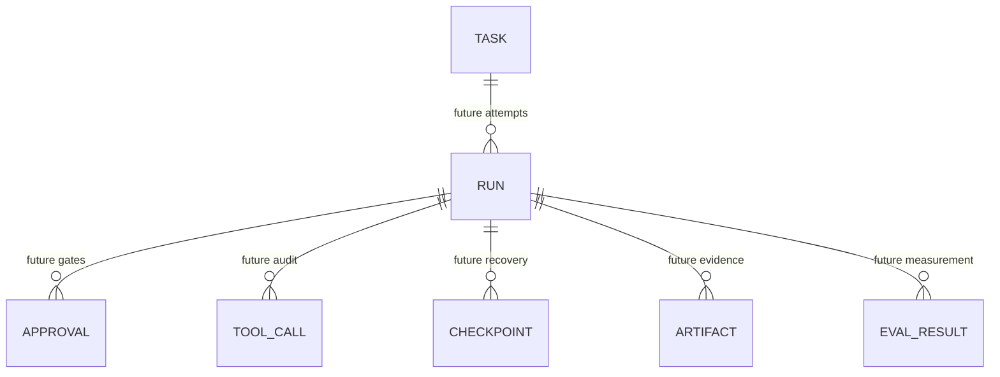

# Data Model

## Implemented in the Foundation target: Task

Only Task belongs in the initial migration.

| Field                      | Type and bounds          | Purpose                                                 |
| -------------------------- | ------------------------ | ------------------------------------------------------- |
| `id`                       | UUID                     | Public stable identifier.                               |
| `title`                    | string, 1-120            | Short task label.                                       |
| `objective`                | string, 1-4000           | Bounded desired outcome.                                |
| `repository_kind`          | `local_path` or `github` | Locator interpretation metadata only.                   |
| `repository_display_name`  | string, 1-120            | Human-facing repository label.                          |
| `repository_locator`       | string, 1-1024           | Untrusted inert metadata; never auto-accessed.          |
| `status`                   | enum, initially `draft`  | Foundation state only.                                  |
| `version`                  | integer, starts at 1     | Future optimistic concurrency control.                  |
| `created_at`               | timezone-aware UTC       | Creation ordering and audit.                            |
| `updated_at`               | timezone-aware UTC       | Last durable change.                                    |
| `idempotency_key`          | bounded internal string  | Unique create-request identity; not returned.           |
| `idempotency_request_hash` | internal SHA-256 digest  | Detect equivalent replay versus conflict; not returned. |

All user strings reject empty/whitespace-only values after normalization,
over-limit values, and NUL characters at the Pydantic API boundary. PostgreSQL
column/check constraints enforce lengths, the repository/status enums, version,
uniqueness, and non-nullability; PostgreSQL text also cannot store NUL. The API
never returns the idempotency key or internal request hash.

`repository_locator` is deliberately an inert string. The Foundation model,
repository, and service pass it only into SQLAlchemy persistence and response
serialization; no filesystem, Git, subprocess, clone, or network operation is
derived from it.

Required database properties:

- primary key on `id`;
- unique constraint or index on `idempotency_key`;
- index supporting descending `created_at` list order with a deterministic
  `id` tie-break;
- explicit transaction handling for uniqueness races;
- timezone-aware database columns.

An idempotency operation is:

1. validate and normalize the request;
2. derive a deterministic fingerprint over the normalized semantic body;
3. attempt a transactional create;
4. on key conflict, read the committed row;
5. return the same Task for the same fingerprint or stable HTTP 409 for a
   different fingerprint.

A pre-insert lookup alone is insufficient because concurrent requests can
race.

## V1 entities: documented, not yet tables

| Entity       | Real problem it solves                                                                                        |
| ------------ | ------------------------------------------------------------------------------------------------------------- |
| `Run`        | Gives one execution attempt its lifecycle, version, policy ceiling, cancellation, failure, and timestamps.    |
| `Approval`   | Binds a human decision to an exact plan/change version and permission scope.                                  |
| `ToolCall`   | Audits requested and actual tool inputs, result class, duration, and policy decision without leaking secrets. |
| `Checkpoint` | Identifies a recoverable repository/worktree state before risky steps.                                        |
| `Artifact`   | References plans, diffs, screenshots, traces, reports, and logs with type, retention, and integrity metadata. |
| `EvalResult` | Stores evaluator version, dataset case, metrics, failure taxonomy, and evidence reference.                    |

These entities should be introduced only with implemented workflows,
constraints, retention policy, and tests. Creating empty tables now would
freeze guesses and imply nonexistent capability.

## Relationship direction

Only the `TASK` box is a Foundation persistence claim. Every relationship in
the diagram is future V1 design.
