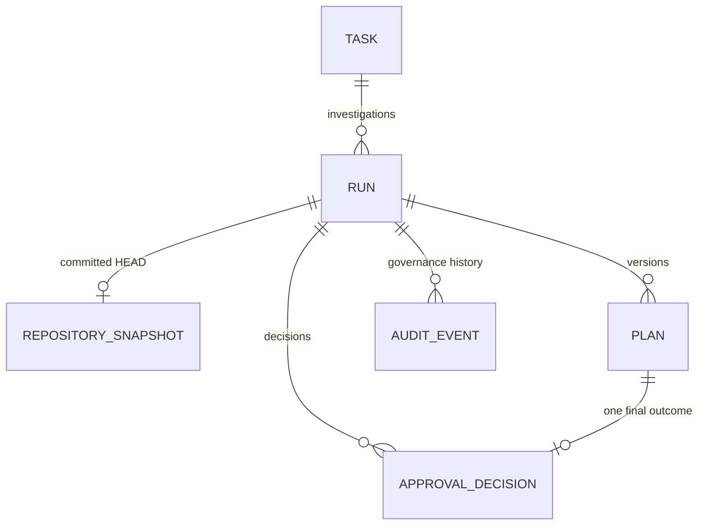

# Data Model

PostgreSQL and Alembic are authoritative for all implemented durable state.
Timestamps are timezone-aware UTC. API enums and database checks enforce the
Phase 2 boundary independently.

## Task

Task stores a bounded title, objective, repository kind/display name/locator,
status, optimistic version, idempotency metadata, and timestamps. A locator is
untrusted metadata until an explicit Level 0 Snapshot request passes scanner
path policy. Task creation is transactionally idempotent.

## Run

| Field group | Invariant                                                          |
| ----------- | ------------------------------------------------------------------ |
| Identity    | UUID `id`, Task foreign key, stable UUID `trace_id`.               |
| Policy      | `permission_level = read_only`; `snapshot_mode = git_head`.        |
| State       | Closed Phase 2 status check and explicit service transition table. |
| Concurrency | Integer `version >= 1`; current Plan version is null or positive.  |
| Failure     | Stable bounded `error_code` and sanitized `error_message`.         |
| Idempotency | Unique optional key plus normalized request hash.                  |
| Time        | Created and updated UTC timestamps.                                |

## RepositorySnapshot

One successful Snapshot may belong to a Run. It stores:

- committed source revision and branch label;
- dirty boolean, total path count, and bounded relative-path/status metadata;
- scanner and scan-policy versions;
- deterministic SHA-256 fingerprint;
- tracked, selected, skipped, and selected-byte counts;
- structured stack, package manager, script names, test surfaces, and
  design-system signals;
- instruction path/hash/provenance/risk metadata;
- sanitized safety findings; and
- a bounded manifest with relative path, entry type, object/hash metadata, and
  skip reason.

It never stores the real host home path, selected source corpus, sensitive
value, dirty/untracked content, or followed symlink content. A unique Run
constraint prevents multiple successful rows. A PostgreSQL trigger rejects
both update and delete.

## Plan

Each Plan has a Run-scoped positive version and one of `draft`,
`awaiting_approval`, `approved`, `rejected`, or `superseded`. Database checks
fix `source` to `deterministic_policy`, limit delivery package, and force
`execution_available = false`.

Plan content includes the bound Snapshot fingerprint, objective and repository
summary, assumptions, proposed scope, non-goals, risks, acceptance criteria,
evidence requirements, stop conditions, typed validation-step JSON, required
future permission level, deterministic content hash, and UTC creation time.
Revision produces a new row rather than changing the prior content.

## ApprovalDecision

ApprovalDecision binds a Run and exact Plan to one `approve` or `reject`
outcome, local-user actor, optional bounded comment, request ID, and timestamp.
A unique Plan constraint permits one final row. A database check requires a
non-blank rejection reason. The service verifies that Run/Plan identities and
latest-version state agree before insertion.

## AuditEvent

AuditEvent stores Run identity, allowlisted event type, local-user/system actor,
request ID, sanitized structured metadata, and UTC creation time. Metadata
contains identifiers, hashes, counts, durations, booleans, and reason codes;
it excludes comments, source text, secrets, exception stacks, and absolute
repository paths.

AuditEvent is governance history, not a full Agent or tool trace.

## Relationships

## Database guarantees and service guarantees

Database constraints enforce valid enums, fixed permission/source/execution
values, non-negative counts, Run-scoped Plan versions, one Snapshot per Run,
one decision per Plan, and immutable Snapshot rows.

The service additionally enforces transition order, Task/Run/Plan association,
latest-version semantics, snapshot-fingerprint binding, editable revision
fields, policy validation, idempotent replay, and redacted failure handling.
Both layers are tested against real PostgreSQL; SQLite is not acceptance
evidence.

## Future entities

Typed ToolCall, isolated-worktree Checkpoint, Artifact, detailed Trace, and
EvalResult tables remain future work. They should be added only with a real
workflow, retention policy, constraints, and evidence.
