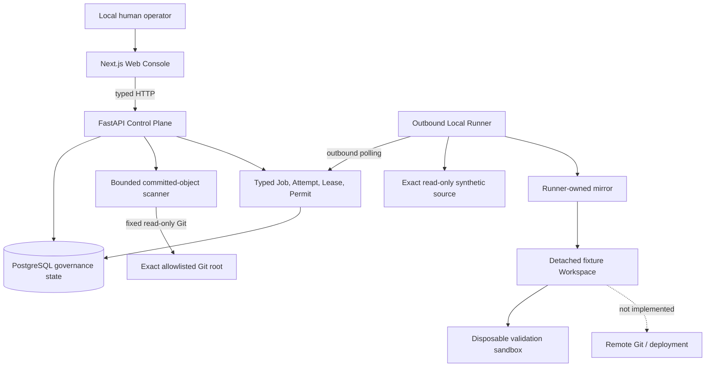
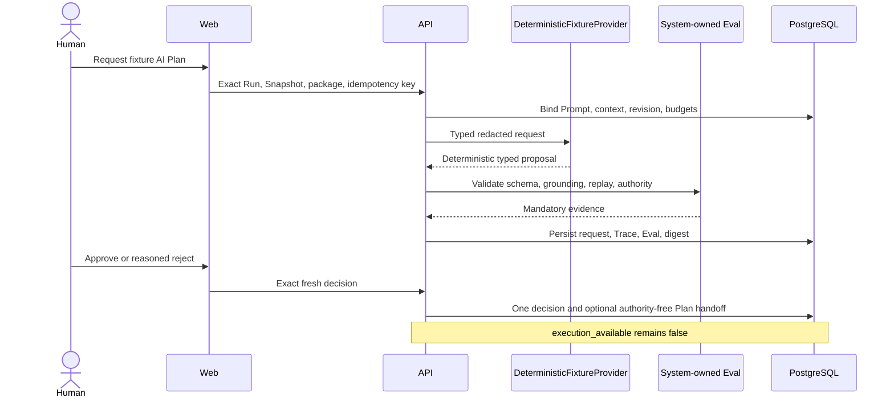

# Architecture Overview

This is the publication-oriented entry point to VisualEngineer's architecture.
It summarizes implemented boundaries without replacing the detailed
[System Overview](system-overview.md), [State Machines](state-machine.md),
[Data Model](data-model.md), [Runner Protocol](runner-protocol.md), or
[Security Boundaries](../security/security-boundaries.md).

## System boundary

### Web boundary

The Web renders state and collects bounded human decisions. It has no direct
database, filesystem, Git, Docker, Runner credential, or repository access.
English and Simplified Chinese use the same typed API and preserve raw IDs,
digests, states, and error codes.

### Control Plane boundary

FastAPI validates closed requests, derives policy, coordinates immutable state,
serializes decisions, and exports OpenAPI. It performs bounded Level 0 Git
reads through the scanner but never executes a Runner Job. PostgreSQL stores
governance facts and independently rejects important invalid transitions or
mutations.

### Runner and Workspace boundary

The Local Runner polls the Control Plane outbound and accepts only versioned
typed Jobs. Only Runner knows the path behind an opaque fixture handle. The
synthetic source is read-only; mirror, Workspace, registry, credentials, and
validation roots are separate Runner-owned locations. There is no general
shell, arbitrary target command, Docker socket, source write, or remote Git.

### PostgreSQL boundary

PostgreSQL is the durable authority for Run/Plan decisions, Provider trace and
eval evidence, Runner/Job/Attempt/Lease state, Grants, Permits, Workspace and
validation evidence, final Review freshness, Delivery Dispatch history, and
the local delivery proof. Alembic is the schema-history source of truth.

## Authority is not transitive

| Record or decision     | What it proves                                                                                                                                  | What it does not authorize                                                |
| ---------------------- | ----------------------------------------------------------------------------------------------------------------------------------------------- | ------------------------------------------------------------------------- |
| AI Plan Approval       | A human accepted one fresh, evaluated plan proposal and its authority-free handoff.                                                             | Workspace creation, execution, validation, review, Git, or deployment.    |
| Execution Grant        | A human approved one immutable fixture Workspace policy bound to the exact Plan, Snapshot, revision, Runner, paths, and budgets.                | Source writes, arbitrary commands, validation, remote Git, or deployment. |
| Review Approval        | A human accepted one fresh immutable evidence package.                                                                                          | Git, local delivery, remote delivery, or deployment.                      |
| Delivery Authorization | A human approved the exact current fixture-only local manifest after review readiness.                                                          | Source write, remote, push, PR, tag, merge, or deploy.                    |
| Side-effect Permit     | Current PostgreSQL authority permits one exact mutation for one active Runner Job/Attempt/Lease/Grant/Workspace/digest within a short deadline. | Any other operation, path, attempt, grant, workspace, or later retry.     |

Every boundary is immutable or append-only where practical, checked for
freshness, and independently scoped. An objective, repository locator,
repository instruction, Provider output, or earlier approval cannot create a
later authority.

## Governed AI planning path

The installed Provider makes no network call, accepts no credential, and
records synthetic non-billable usage. A future real Provider requires a new
credential, network, evaluation, observability, and security design; the
current protocol is a seam, not permission.

## Fixture-only demonstration

The ordinary local stack starts with `make platform-up`. A complete AI planning
walkthrough needs an API-visible synthetic repository and is documented in
[Fixture AI Planning Demo](../runbooks/fixture-ai-planning-demo.md). The demo
uses only repository-owned fixture generators and existing Compose overrides,
and it does not pre-approve a plan.

Use the interface-language selector to switch `en-US` and `zh-CN`. Provider
identity, request/Prompt/context digests, Eval results, freshness, and
`execution_available=false` remain inspectable in both languages.

## Default behavior without a Provider key

There is no real Provider environment variable in `.env.example` and no real
Provider SDK in the implemented path. `DeterministicFixtureProvider` is the
default. Adding an API key alone would enable nothing and is outside this
repository-publication scope.

## Deployment posture

Docker Compose is a local development and verification topology. It is not a
public or production deployment. Authentication, multi-tenancy, production
secret management, backups, hardened egress, remote Git, public hosting, and
deployment remain outside the implemented boundary.
