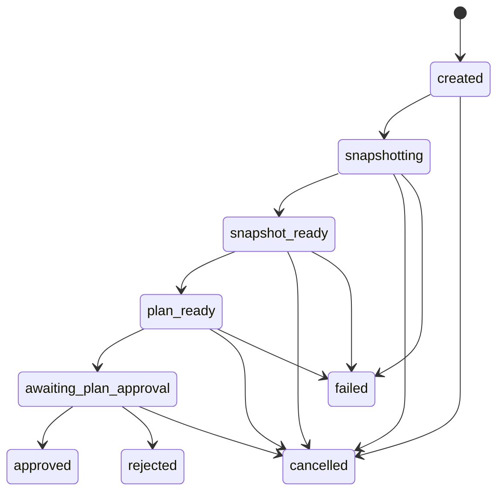
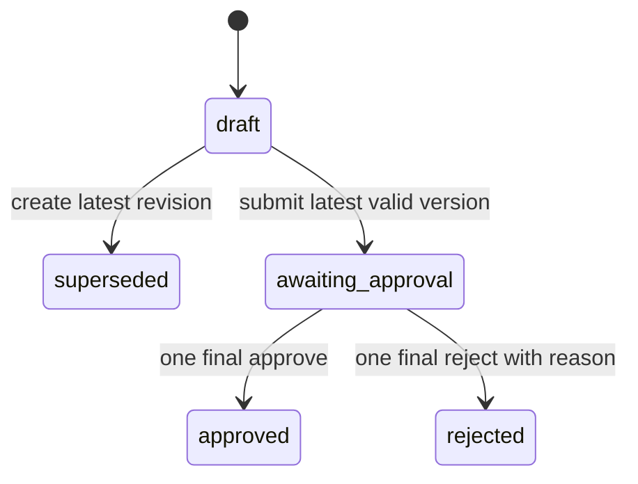
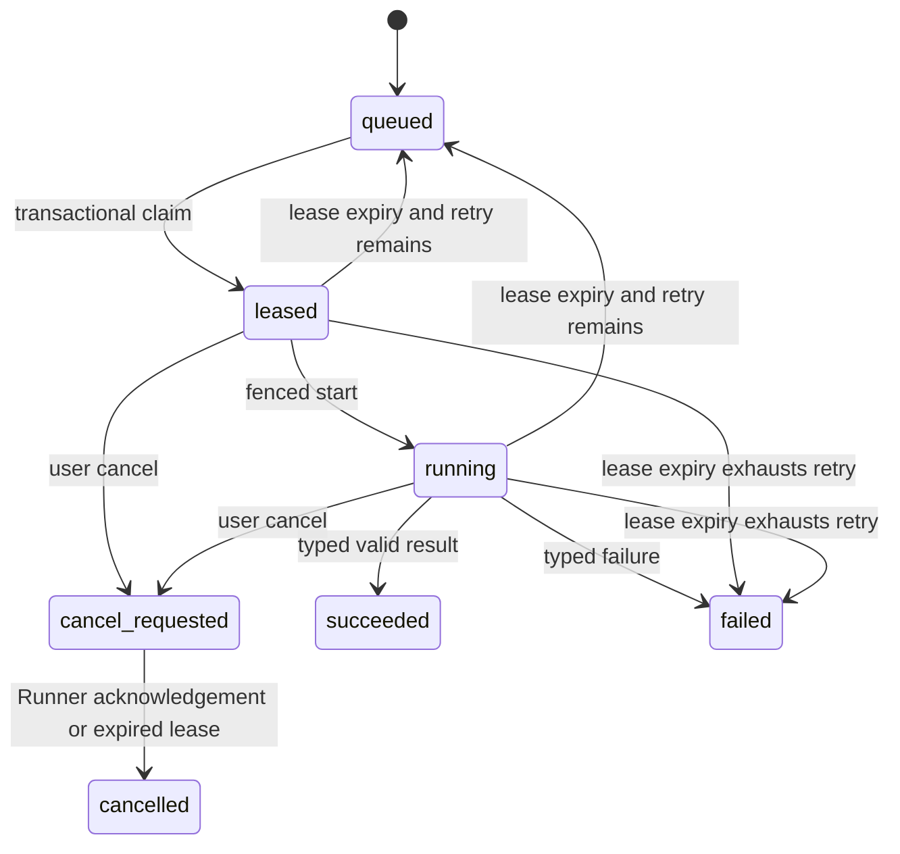
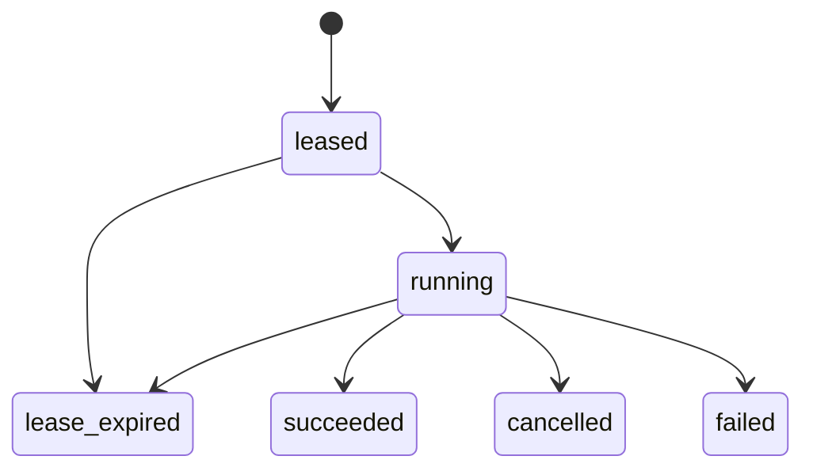
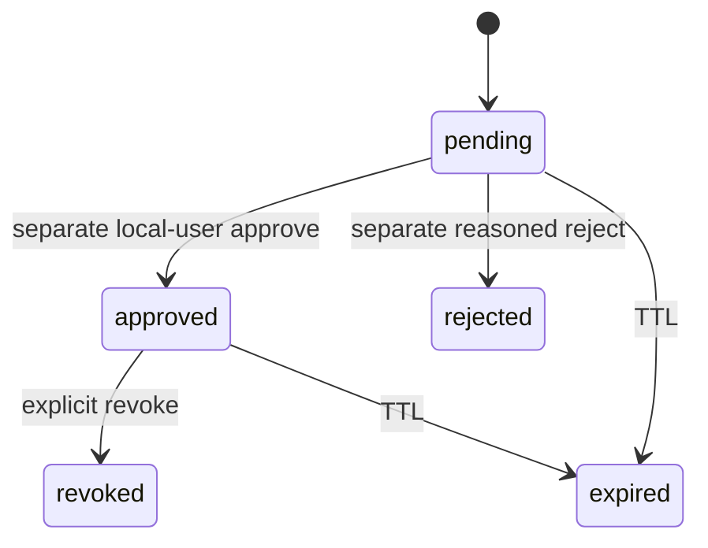
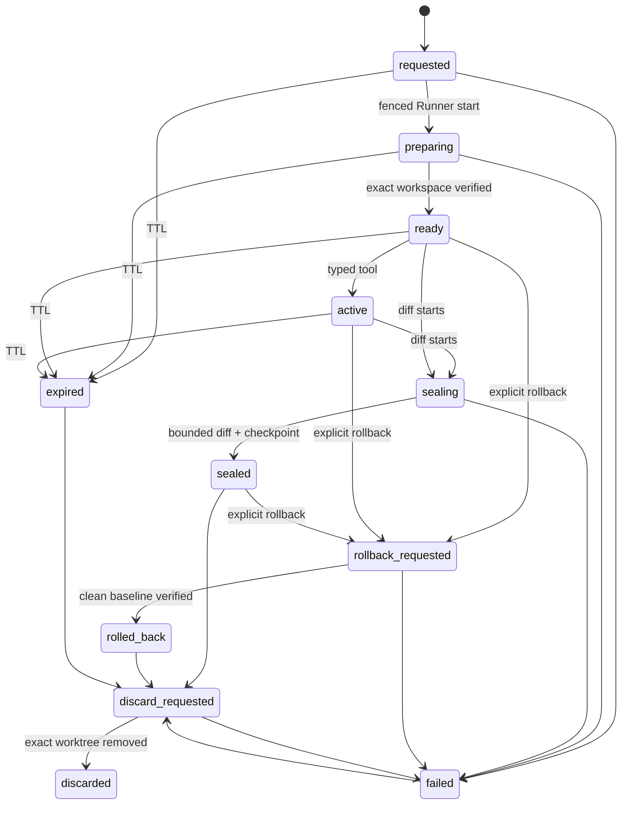

# Run State Machine

## Implemented Phase 2 lifecycle

The service owns a closed transition table; routes cannot assign state
directly.

`approved`, `rejected`, `failed`, and `cancelled` are terminal in Phase 2.
There is intentionally no `executing` transition.

## State meanings

| State                    | Meaning                                                   | Exit gate                                |
| ------------------------ | --------------------------------------------------------- | ---------------------------------------- |
| `created`                | Level 0 Run exists; no repository scan began.             | Explicit Snapshot request.               |
| `snapshotting`           | Bounded committed-object scan is active.                  | Immutable Snapshot or redacted failure.  |
| `snapshot_ready`         | One successful Snapshot is durable.                       | Deterministic Plan creation.             |
| `plan_ready`             | Latest Plan is a reviewable draft.                        | Valid latest-version submission.         |
| `awaiting_plan_approval` | Latest Plan awaits the local user.                        | One approve or reasoned reject decision. |
| `approved`               | Exact Plan version was approved as a governance decision. | None in Phase 2.                         |
| `rejected`               | Exact Plan version was rejected.                          | None in Phase 2.                         |
| `failed`                 | Run stopped safely with a stable redacted error.          | None in Phase 2.                         |
| `cancelled`              | User stopped a pre-decision Run.                          | None in Phase 2.                         |

## Plan lifecycle

A revision creates `version + 1`, copies immutable context, applies only
allowlisted editable fields, recomputes the content hash, and supersedes the
prior draft. Only the latest draft may be revised or submitted. Only the latest
awaiting Plan may be decided. An approved Run cannot create another version.

## Conflict and idempotency rules

- Run creation replays only when the same idempotency key represents the same
  normalized request; otherwise it returns a stable conflict.
- A completed Snapshot request returns the existing immutable Snapshot.
- Re-creating the same initial draft returns that draft; subsequent versions
  use the revision endpoint.
- Re-submitting the same awaiting Plan is idempotent.
- An identical final decision and comment replay returns the decision.
- A stale version returns `409`.
- A different decision after a winner returns `decision_conflict`.
- PostgreSQL row locks and the unique `plan_id` decision constraint allow only
  one winner in a concurrent approve/reject race.

## Invariants

- `permission_level` is always `read_only`.
- `snapshot_mode` is always `git_head`.
- One successful immutable Snapshot exists at most once per Run.
- Every Plan binds that Snapshot fingerprint and has
  `source = deterministic_policy`.
- `execution_available` is always false at both API and database boundaries.
- Rejection requires a non-blank reason.
- Every material transition appends a sanitized AuditEvent with request ID.
- Approval records a human decision only; it does not authorize or trigger
  code execution, a worktree, a command, Git, PR, or deployment action.

## Phase 3 Runner Job lifecycle

Runner Job state is independent of Run/Plan state. Plan approval has no
transition into this machine.

`succeeded`, `cancelled`, and `failed` are terminal. Queued cannot become
succeeded directly. `cancel_requested` cannot become succeeded. Routes call a
single explicit transition table rather than assigning state freely.

## Runner Attempt lifecycle

A Job has at most one active `leased`/`running` Attempt. Claim increments the
attempt number and issues a new random Lease UUID. Every mutation repeats
Runner, Attempt, and Lease identity. The service locks and verifies the active
pointer and deadline; expired or superseded identity returns `409 stale_lease`.

The reaper marks expired Attempts and either requeues the Job, fails it after
the finite retry budget, or completes an already requested cancellation. A
PostgreSQL advisory lock prevents duplicate reaper passes.

## Runner idempotency

- Identical repeated start/renew/terminal requests return a replay marker.
- A different result or failure classification after a terminal write
  conflicts.
- Repeated user cancel is idempotent while pending or complete.
- Completion after cancellation returns `completion_after_cancel`.
- Heartbeats update `last_seen_at` without creating an event per heartbeat.

## Phase 4 Execution Grant lifecycle

Policy fields never transition: a PostgreSQL trigger rejects updates and
deletes. Decision, revocation, and expiry services may change status only.
Plan approval creates neither a Grant nor an approval decision. A rejected,
revoked, or expired Grant cannot dispatch or complete a Runner Job.

## Phase 4 Workspace lifecycle

One non-terminal Workspace may exist per Grant. Every action verifies the
Workspace/Runner/Handle/revision/Grant/policy binding and its allowed source
state under a row lock. Workspace expiry precedes Grant expiry, leaving a
bounded discard window. Grant revocation/expiry fences all Jobs and is never
bypassed for cleanup.

Successful create/replace and diff append immutable Checkpoints. Rollback is
initial-baseline-only and must return clean status plus the original tree hash.
Discard is idempotent only after the exact disposal Job has durable evidence.
