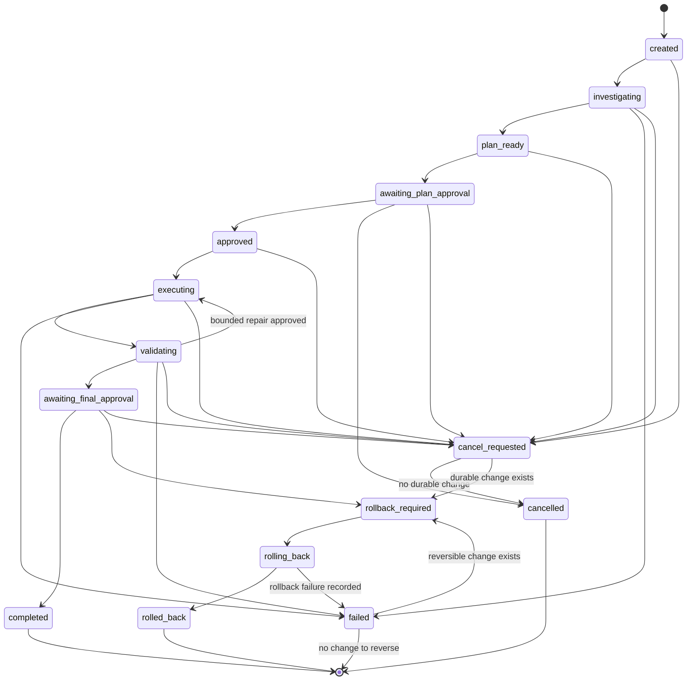

# Run State Machine

## Foundation reality

The Foundation database formally implements only a Task with status `draft`.
There is no Run entity, orchestration loop, approval engine, tool executor, or
rollback engine in this phase. The lifecycle below is a V1 design constraint,
not a claim of current execution.

## Future Run lifecycle

## State meanings and gates

| State                     | Meaning                                              | Required exit evidence                               |
| ------------------------- | ---------------------------------------------------- | ---------------------------------------------------- |
| `created`                 | Run accepted; no repository access yet.              | Policy and target binding.                           |
| `investigating`           | Level 0 read-only inspection is active.              | Cited facts, uncertainty, unchanged target baseline. |
| `plan_ready`              | A bounded plan and validation/rollback design exist. | Plan artifact and permission request.                |
| `awaiting_plan_approval`  | No write is allowed; awaiting human decision.        | Signed/attributed approval or rejection.             |
| `approved`                | Exact plan and permission ceiling approved.          | Immutable approval reference.                        |
| `executing`               | Scoped work in an isolated worktree.                 | Tool-call audit and checkpoints.                     |
| `validating`              | Controlled tests/browser checks are running.         | Command, exit, artifacts, failure class.             |
| `awaiting_final_approval` | Change and evidence ready for human review.          | Final approval or rollback decision.                 |
| `completed`               | Authorized deliverable finished.                     | Required checks and delivery evidence.               |
| `failed`                  | Work cannot safely continue.                         | Root cause, residual changes, recovery option.       |
| `cancel_requested`        | Cancellation requested; safe point sought.           | Tool quiescence and change assessment.               |
| `cancelled`               | Stopped with no outstanding reversible change.       | Cleanup evidence.                                    |
| `rollback_required`       | Durable scoped changes need reversal.                | Checkpoint and approved rollback action.             |
| `rolling_back`            | Bounded rollback in progress.                        | Audited rollback actions.                            |
| `rolled_back`             | Scoped changes restored to checkpoint.               | Target status and artifact evidence.                 |

## Invariants

- Only a human approval can cross into repository-writing execution.
- Approval binds a plan version, repository/worktree identity, allowed paths,
  commands, time window, and maximum permission level.
- Cancellation never silently discards an in-flight external effect.
- `completed` is impossible with a mandatory failed or missing check.
- Rollback failure remains `failed`; it must not be relabeled `rolled_back`.
- Every transition is idempotent, version-checked, timestamped in UTC, and
  attributable.
