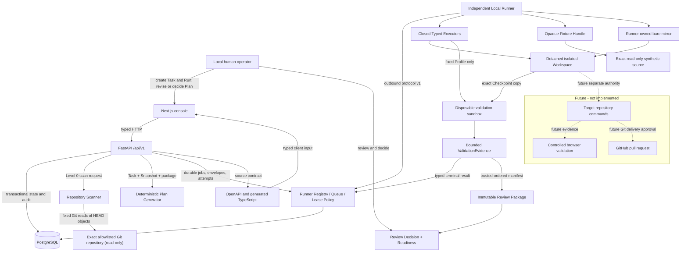
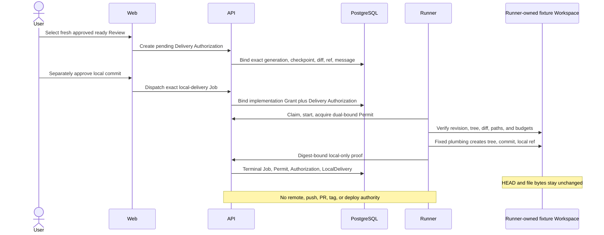

# System Overview

VisualEngineer through the Phase 5 Third Vertical Slice is a local, single-user
governed planning, fixture-only isolated editing, fixed-Profile validation,
system-owned multi-step Suite, and immutable final-review/readiness
foundation. Solid nodes below are implemented. Dashed nodes are future V1
boundaries.



## Implemented responsibilities

### Web

The web application renders Task/Run history, state, permission and snapshot
mode, committed repository intelligence, safety findings, deterministic Plan
versions, typed validation steps, decision controls, and the Audit Timeline.
It also renders Runner Registry, immutable Envelope previews, typed Dispatch,
Job/Attempt state, progress, cancellation, results, and RunnerJobEvent
Timeline. It owns no database, filesystem, Git, Docker, shell, Runner
credential, or target-repository access.

The `/validations` surface lists the fixed Profiles and one immutable Suite,
derives a pending validation-only Grant from an exact eligible Workspace
Checkpoint, preserves a separate human approve/reject decision, creates/
cancels a Validation Run or Suite Run, and renders ordered child timelines and
bounded aggregate Evidence. It has no step editor, command, argv, environment,
package, URL, or free-form tool input.

The `/reviews` surface selects only the latest successful Suite Result, renders
its immutable ordered Evidence Manifest and digests, rechecks freshness,
records one local-user Review Decision, and computes one deterministic
readiness verdict. It displays that Git and deployment authorization are
always false.

### API

The API validates requests, preserves request IDs, applies stable error codes,
owns Run and Plan state policy, coordinates repository scanning, generates
deterministic plans, serializes final decisions, writes sanitized audit
events, and exports OpenAPI. Routes delegate to typed services and
repositories.

The API also owns Runner bootstrap authentication, digest-only credential
verification, derived liveness, revocation, server-side Envelope derivation,
transactional claim, explicit Job/Attempt transitions, lease renewal,
cancellation, typed results/events, and lease recovery. It never executes a
Runner Job.

### Local Runner

The independent long-running Runner makes outbound calls only. It persists its
credential in a dedicated Docker volume, validates every Envelope, and invokes
one closed typed executor. System Diagnostic and Controlled Wait remain
repository-free. For Phase 4 only, Runner maps an opaque handle to the exact
read-only synthetic fixture, owns a bare mirror/detached worktree/registry, and
executes descriptor-safe UTF-8 file tools plus fixed Git status/diff/restore/
discard. It has no shell, arbitrary command, target command, Docker socket,
inbound port, database/Web network, or public network.

For Phase 5, Runner also owns a separate dedicated validation volume. It
verifies the exact canonical Workspace/Checkpoint, copies bounded fixture input
into a UUID-addressed root, and invokes one fixed Python-standard-library
Profile under Landlock filesystem confinement, seccomp network denial,
resource limits, monotonic timeout/cancel, bounded output, process-group
cleanup, and exact sandbox removal. It never runs a user command or mutates the
canonical Workspace.

The Control Plane, not Runner, owns Suite orchestration. It selects immutable
catalog steps and queues only one existing fixed-Profile child at a time. Each
child retains an independent Job, Attempt, Lease, Permit, result, Evidence, and
sandbox. Runner receives no Suite definition or caller-provided step.

### Repository Scanner

The scanner:

1. expands and canonically resolves an absolute local path;
2. verifies allowlist membership, exact Git root, and non-symlink root;
3. uses fixed no-shell Git argument arrays with prompts, hooks, optional locks,
   global/system config, and network protocols disabled;
4. obtains branch, `HEAD`, bounded status paths, and the committed tree;
5. classifies entries before reading;
6. reads only policy-selected committed blobs by object ID;
7. rejects sensitive, binary, oversized, symlink, submodule, and LFS content;
   and
8. returns structured facts and a deterministic fingerprint.

No working-tree file is opened. Dirty/untracked content is not read.

### Deterministic Plan Generator

The generator uses only the Task, immutable Snapshot, selected delivery
package, and versioned product policy. It does not call a model. Plan
validation steps use a closed schema and are displayed rather than executed.
Revision validation is a bounded Foundation string policy; future execution
still requires typed tool schemas and an independent runtime policy layer.

### PostgreSQL

PostgreSQL stores Task, Run, RepositorySnapshot, Plan, ApprovalDecision,
AuditEvent, Runner, PermissionEnvelope, RunnerJob, RunnerJobAttempt,
RunnerJobEvent, RepositoryHandle, ExecutionGrant/Decision, Workspace/Event,
Checkpoint, ValidationRun, ValidationStepRun, ValidationEvidence,
ValidationSuiteRun, ValidationSuiteStepRun, ValidationSuiteResult,
ReviewPackage/Invalidation, ReviewDecision, and ReleaseReadinessVerdict.
Alembic owns schema history. Row locks and uniqueness serialize decisions,
claims, workspace actions, validation/Suite dispatch, terminal evidence, and
final review. Database triggers reject Snapshot, PermissionEnvelope, Execution
Grant policy, Checkpoint, validation evidence, Suite authority, terminal
aggregate, and governed review mutation.

### Contract

FastAPI OpenAPI is authoritative. TypeScript types are generated from it.
Contract drift regenerates both artifacts and requires no diff.

## Governed request sequence

```mermaid
sequenceDiagram
    actor User
    participant Web
    participant API
    participant Git as Read-only Git repository
    participant DB as PostgreSQL

    User->>Web: Start read-only investigation
    Web->>API: Create Level 0 Run
    API->>DB: Run created + audit
    Web->>API: Create Snapshot
    API->>DB: Run snapshotting + audit
    API->>Git: Fixed metadata and committed-object reads
    Git-->>API: HEAD tree and selected blobs
    API->>DB: Immutable Snapshot + fingerprint + audit
    Web->>API: Create deterministic Plan
    API->>DB: Draft Plan bound to fingerprint
    User->>Web: Revise and submit exact version
    API->>DB: Supersede old draft; awaiting approval
    User->>Web: Approve or reject
    API->>DB: One final decision + terminal Phase 2 state
    Note over API,Git: No code or command execution follows approval
```

## Customer 0 deployment boundary

The historical Phase 2 Customer 0 override mounts only the exact CreativeDeploy repository into
the API at `/repositories/customer0/creative-deploy` with `read_only: true`.
The Web and database receive no repository mount. The API runs as a non-root
user. The host path is supplied only at invocation and is not committed.
The Phase 3 base platform and Phase 4 fixture Runner do not use this override
and do not mount, scan, read, or modify CreativeDeploy.

## Runner dispatch sequence

```mermaid
sequenceDiagram
    actor User
    participant Web
    participant API
    participant DB as PostgreSQL
    participant Runner

    Runner->>API: Register with bootstrap credential
    API->>DB: Runner identity + token digest
    API-->>Runner: Runner Token returned once
    Runner->>API: Heartbeat and bounded claim poll
    User->>Web: Review fixed Envelope and dispatch typed Job
    Web->>API: Job kind + closed parameters only
    API->>DB: Immutable Envelope + queued Job + event
    Runner->>API: Claim
    API->>DB: SKIP LOCKED claim + fenced Attempt
    Runner->>API: Validate Envelope; start; renew/progress
    User->>Web: Optionally request cancellation
    API->>DB: cancel_requested
    Runner->>API: Typed complete or cancelled acknowledgement
    API->>DB: Terminal state + sanitized evidence
```

## Phase 4 workspace sequence

```mermaid
sequenceDiagram
    actor User
    participant Web
    participant API
    participant DB as PostgreSQL
    participant Runner
    participant Source as Read-only fixture

    Runner->>API: Register opaque Handle + committed revision
    User->>Web: Create pending Grant from approved Plan
    User->>Web: Separately approve exact Grant
    API->>DB: Immutable policy + decision
    User->>Web: Create Workspace
    API->>DB: Bound typed prepare Job
    Runner->>Source: Verify read-only root and exact revision
    Runner->>Runner: Populate bare mirror; detached worktree
    Runner->>API: Fenced ready result + fingerprints
    User->>Web: Typed read/create/replace/status/diff
    API->>DB: Fenced results, events, checkpoints
    User->>Web: Baseline rollback; exact discard
    Runner->>API: Verified clean/discarded evidence
    Note over Source: HEAD, status, contents, and .git remain unchanged
```

The source, mirror, workspace, and registry mounts exist only in Runner. See
[`isolated-workspaces.md`](isolated-workspaces.md) for budgets and platform
limits.

## Phase 5 validation sequence

```mermaid
sequenceDiagram
    actor User
    participant Web
    participant API
    participant DB as PostgreSQL
    participant Runner
    participant Workspace as Canonical fixture Workspace
    participant Sandbox as Disposable validation root

    User->>Web: Select fixed Profile + exact Checkpoint
    Web->>API: Create pending validation-only Grant
    User->>Web: Separately approve exact Grant
    API->>DB: Immutable scope, budgets, and decision
    User->>Web: Create Validation Run
    API->>DB: Bound Run + Job + immutable Envelope
    Runner->>API: Fenced claim and start
    Runner->>Workspace: Verify exact tree and bounded regular input
    Runner->>Sandbox: Copy input; apply Landlock + seccomp + limits
    Runner->>Sandbox: Run fixed system-owned Profile
    Runner->>API: Bounded result + cleanup proof
    API->>DB: Terminal state + immutable evidence
    Note over Workspace: State and bytes remain unchanged
```

## Phase 5 final review sequence

```mermaid
sequenceDiagram
    actor User
    participant Web
    participant API
    participant DB as PostgreSQL

    User->>Web: Select latest successful Suite Result
    Web->>API: Create immutable Review Package
    API->>DB: Lock generation; reconstruct Evidence, policy, Grant, blockers
    DB-->>API: Canonical Manifest/package/blocker digests
    User->>Web: Recheck freshness and inspect exact Evidence
    User->>Web: Approve or reasoned reject
    API->>DB: Bind expected generation + keyed immutable Decision
    User->>Web: Compute Release Readiness
    API->>DB: Recompute full chain; require blocker counts 0/0/0
    API-->>Web: ready, not_ready, or effective stale
    Note over API,DB: Later trusted fact atomically invalidates old generation
    Note over Web,DB: Git and deployment authorization remain false
```

## Deployment posture

Compose is a local development and verification environment, not a production
deployment. Authentication, secrets management, tenant isolation, backups,
high availability, hardened networking, remote CI evidence, and production
operations remain unimplemented.

## Phase 6 governed local-delivery sequence


