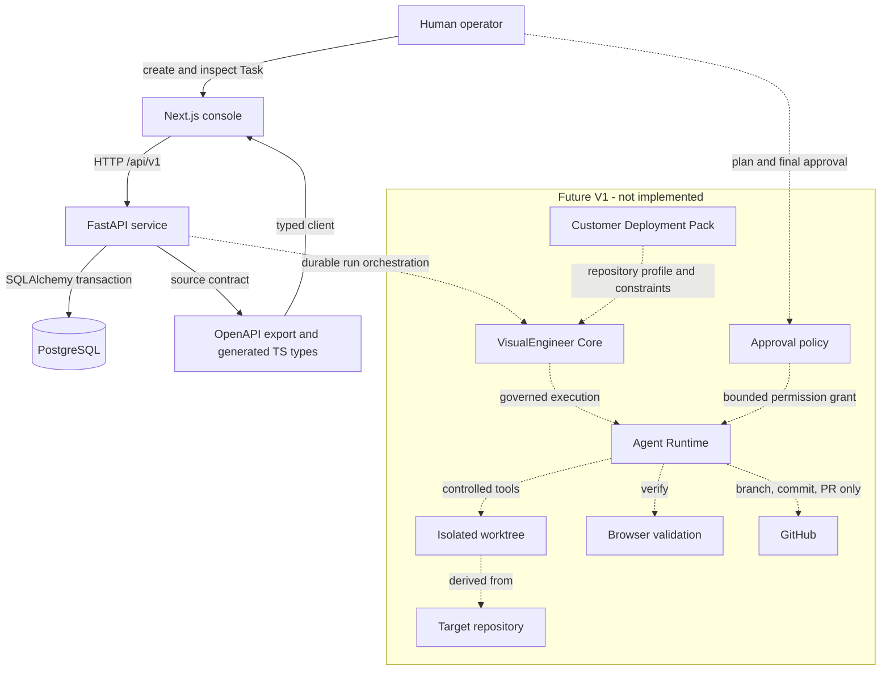
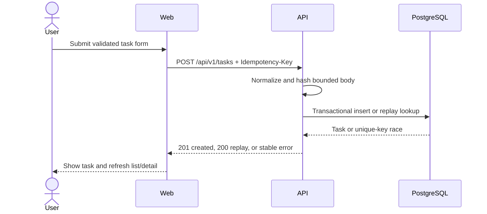

# System Overview

VisualEngineer is architected as a governed AI delivery platform for enterprise
frontend teams. The current solid-line system is only the Foundation task
registry. Future V1 execution is limited to Design Implementation,
Design-System Migration, and Frontend Quality Remediation.

## Status legend

- Solid nodes and arrows are implemented Foundation boundaries.
- Dashed nodes and arrows are future V1 boundaries and are not implemented.
- Runtime behavior is verified in
  [`../evidence/phase-0-1-verification.md`](../evidence/phase-0-1-verification.md).

## Core and Deployment Pack boundary

Future **VisualEngineer Core** owns Task/Run orchestration, approvals, safe
workspace lifecycle, tool-permission enforcement, validation, traces,
evaluations, evidence generation, and recovery/rollback boundaries.

A customer **Deployment Pack** provides:

- repository identity and profile;
- customer and path constraints;
- allowed commands;
- design-system and brand context;
- acceptance criteria;
- test strategy;
- a project-specific delivery playbook.

Core remains authoritative for permission and approval. A Deployment Pack is
untrusted configuration and cannot add capabilities, relax safety policy, or
claim a command passed. Foundation stores repository metadata only and has no
runtime Core or executable Deployment Pack implementation.

## Foundation boundaries

### Web

The web application owns presentation, browser-side form validation, request
initiation, and user-visible states. It has no direct database, filesystem,
Docker, shell, external repository, or GitHub access.

### API

The API owns validation, idempotency, error mapping, request IDs, and task
operations. API configuration comes from environment variables or conservative
local defaults. CORS is restricted to configured web origins. Database errors
must not expose stack traces or connection details.

### Database

PostgreSQL is the durable store. Alembic owns schema evolution. The Foundation
schema contains only the Task entity; future orchestration entities are
documented, not created prematurely.

### Contract

FastAPI's exported OpenAPI JSON is authoritative. TypeScript types are
generated from it. A drift check regenerates artifacts and requires a clean
diff.

## Request path

The locator remains an inert string throughout this sequence.

## Deployment posture

Foundation Compose is for local development and verification. A local
migration command may precede API start. Any production design must use a
single, dedicated release/migration step and non-root workloads, plus
authentication, secrets management, backups, observability, and hardened
networking. No production deployment is part of this phase.
