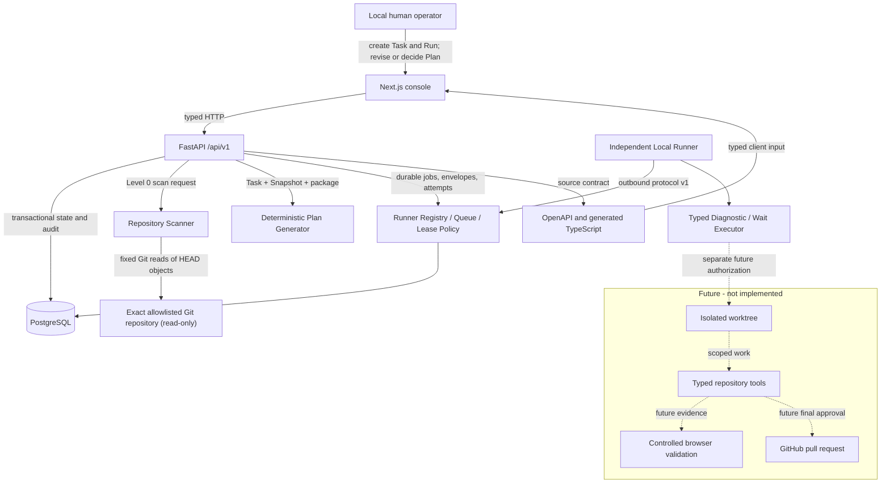

# System Overview

VisualEngineer Phase 3 is a local, single-user governed planning and
repository-free execution foundation. Solid nodes below are implemented.
Dashed nodes are future V1 boundaries.



## Implemented responsibilities

### Web

The web application renders Task/Run history, state, permission and snapshot
mode, committed repository intelligence, safety findings, deterministic Plan
versions, typed validation steps, decision controls, and the Audit Timeline.
It also renders Runner Registry, immutable Envelope previews, typed Dispatch,
Job/Attempt state, progress, cancellation, results, and RunnerJobEvent
Timeline. It owns no database, filesystem, Git, Docker, shell, Runner
credential, or target-repository access.

### API

The API validates requests, preserves request IDs, applies stable error codes,
owns Run and Plan state policy, coordinates repository scanning, generates
deterministic plans, serializes final decisions, writes sanitized audit
events, and exports OpenAPI. Routes delegate to typed services and
repositories.

The API also owns Runner bootstrap authentication, digest-only credential
verification, derived liveness, revocation, server-side Envelope derivation,
transactional claim, explicit Job/Attempt transitions, lease renewal,
cancellation, typed results/events, and lease recovery. It never executes a
Runner Job.

### Local Runner

The independent long-running Runner makes outbound calls only. It persists its
credential in a dedicated Docker volume, validates every Envelope, and invokes
one in-process typed executor. System Diagnostic returns a redacted closed
schema; Controlled Wait exercises renewal/progress/cancellation. Runner has no
repository, shell, subprocess executor, worktree, Git, database/Web network,
Docker socket, inbound port, or public network.

### Repository Scanner

The scanner:

1. expands and canonically resolves an absolute local path;
2. verifies allowlist membership, exact Git root, and non-symlink root;
3. uses fixed no-shell Git argument arrays with prompts, hooks, optional locks,
   global/system config, and network protocols disabled;
4. obtains branch, `HEAD`, bounded status paths, and the committed tree;
5. classifies entries before reading;
6. reads only policy-selected committed blobs by object ID;
7. rejects sensitive, binary, oversized, symlink, submodule, and LFS content;
   and
8. returns structured facts and a deterministic fingerprint.

No working-tree file is opened. Dirty/untracked content is not read.

### Deterministic Plan Generator

The generator uses only the Task, immutable Snapshot, selected delivery
package, and versioned product policy. It does not call a model. Plan
validation steps use a closed schema and are displayed rather than executed.
Revision validation is a bounded Foundation string policy; future execution
still requires typed tool schemas and an independent runtime policy layer.

### PostgreSQL

PostgreSQL stores Task, Run, RepositorySnapshot, Plan, ApprovalDecision,
AuditEvent, Runner, PermissionEnvelope, RunnerJob, RunnerJobAttempt, and
RunnerJobEvent. Alembic owns schema history. Row locks and uniqueness serialize
final plan decisions and Runner claims. Database triggers reject Snapshot and
PermissionEnvelope mutation.

### Contract

FastAPI OpenAPI is authoritative. TypeScript types are generated from it.
Contract drift regenerates both artifacts and requires no diff.

## Governed request sequence

```mermaid
sequenceDiagram
    actor User
    participant Web
    participant API
    participant Git as Read-only Git repository
    participant DB as PostgreSQL

    User->>Web: Start read-only investigation
    Web->>API: Create Level 0 Run
    API->>DB: Run created + audit
    Web->>API: Create Snapshot
    API->>DB: Run snapshotting + audit
    API->>Git: Fixed metadata and committed-object reads
    Git-->>API: HEAD tree and selected blobs
    API->>DB: Immutable Snapshot + fingerprint + audit
    Web->>API: Create deterministic Plan
    API->>DB: Draft Plan bound to fingerprint
    User->>Web: Revise and submit exact version
    API->>DB: Supersede old draft; awaiting approval
    User->>Web: Approve or reject
    API->>DB: One final decision + terminal Phase 2 state
    Note over API,Git: No code or command execution follows approval
```

## Customer 0 deployment boundary

The historical Phase 2 Customer 0 override mounts only the exact CreativeDeploy repository into
the API at `/repositories/customer0/creative-deploy` with `read_only: true`.
The Web and database receive no repository mount. The API runs as a non-root
user. The host path is supplied only at invocation and is not committed.
The Phase 3 base platform and Runner do not use this override and do not mount,
scan, read, or modify CreativeDeploy.

## Runner dispatch sequence

```mermaid
sequenceDiagram
    actor User
    participant Web
    participant API
    participant DB as PostgreSQL
    participant Runner

    Runner->>API: Register with bootstrap credential
    API->>DB: Runner identity + token digest
    API-->>Runner: Runner Token returned once
    Runner->>API: Heartbeat and bounded claim poll
    User->>Web: Review fixed Envelope and dispatch typed Job
    Web->>API: Job kind + closed parameters only
    API->>DB: Immutable Envelope + queued Job + event
    Runner->>API: Claim
    API->>DB: SKIP LOCKED claim + fenced Attempt
    Runner->>API: Validate Envelope; start; renew/progress
    User->>Web: Optionally request cancellation
    API->>DB: cancel_requested
    Runner->>API: Typed complete or cancelled acknowledgement
    API->>DB: Terminal state + sanitized evidence
```

## Deployment posture

Compose is a local development and verification environment, not a production
deployment. Authentication, secrets management, tenant isolation, backups,
high availability, hardened networking, remote CI evidence, and production
operations remain unimplemented.
