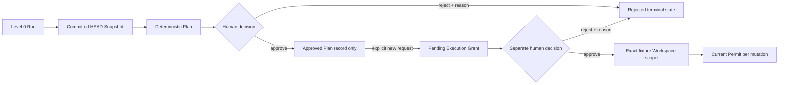

# Tool Permission Model

## Principles

Permissions are deny-by-default, scope-bound, non-transitive, and elevated
only by an explicit independent human Grant. Repository content, a Task
objective, a Deployment Pack, or Plan approval cannot grant a capability.

Phase 2 implements Level 0 repository intelligence. Phase 3 additionally
implements repository-free execution-plane capabilities. Phase 4 implements
Level 1 only for the synthetic fixture and still has no generic tool executor.

## Levels

| Level                    | Capability                                                                                                            | Status           |
| ------------------------ | --------------------------------------------------------------------------------------------------------------------- | ---------------- |
| 0: Read only             | Fixed metadata and selected committed-object reads inside one exact allowlisted Git root. No target command or write. | **Implemented**  |
| 1: Isolated write        | Edit exact approved UTF-8 paths in a Runner-owned isolated fixture worktree.                                          | **Fixture only** |
| 2: Controlled validation | Run allowlisted install/format/lint/test/build/browser schemas in isolation.                                          | Not implemented  |
| 3: Branch and commit     | Create a scoped branch and local commit after gates.                                                                  | Not implemented  |
| 4: Pull request          | Push the approved branch and create/update a PR.                                                                      | Not implemented  |

## Phase 3 repository-free capabilities

System Diagnostic and Controlled Wait are closed Job kinds outside the
repository permission ladder. Their immutable Envelope fixes:

```text
repository_access = none
shell_access = false
network_policy = control_plane_only
```

The browser cannot edit the Envelope. A Plan, Task, repository locator,
Deployment Pack, or repository instruction cannot dispatch a Job or broaden
authority. System Diagnostic returns only redacted runtime facts; Controlled
Wait uses async time and cancellation. Neither accesses project code,
filesystem content, a shell, subprocess executor, Git, or public network.

## Implemented fixture-only Level 1

The authority chain is approved exact Plan/Snapshot, pending Execution Grant,
separate local-user approve, Workspace binding, typed Job/Envelope, fenced
Attempt, and a current Side-effect Permit immediately before each mutation.
The server-derived Grant fixes:

```text
repository = fixture-repository-v1 at exact revision
allowed paths = sandbox/**
denied paths = .git, .env, credential/token/key/certificate classes
operations = prepare/list/read/write/status/diff/rollback/discard
max changed files = 8
max total submitted write bytes = 128 KiB
max one text file / diff = 32 KiB
workspace TTL = 20 minutes
network = none
shell/source write/Git delivery = false
```

Only Runner knows the source path. The source is read-only, no Git process is
run against it, and every write occurs in a detached Runner-owned worktree.
List/read/create/compare-and-swap replace are descriptor-rooted and bounded.
Fixed Runner-owned Git status/diff, immutable checkpoints, initial-baseline
rollback, and Permit plus signed-ownership-bound UUID-only discard complete
the scope. There is no delete/rename/binary tool or target command.

## Implemented Level 0 controls

- `permission_level` is fixed to `read_only` in schema and database.
- The locator must be an absolute canonical path inside configured roots and
  identify the exact non-symlink Git root.
- Git calls use fixed argument arrays, no shell, no global/system config, no
  prompt, no hooks, no optional locks, and `protocol.allow=never`.
- Facts come from `HEAD` tree entries and selected blob object IDs.
- Dirty and untracked state contributes bounded relative paths and status only.
- Sensitive names are denied before read; secret-like selected content is
  discarded without recording a matched value.
- Symlinks are not followed, submodules are not initialized, LFS is not
  fetched, and dependency trees are not loaded.
- Count, selection, per-file, total-byte, dirty-path, and shared-time budgets
  bound work.
- Package scripts and Make targets are parsed as typed names only.
- Repository instructions are recorded as untrusted provenance and cannot
  affect permission.

## Approval semantics



Plan approval binds an exact Plan version and fingerprint as a governance
record. It does not elevate the Run or create a worktree. Only a separately
approved immutable Grant can scope the implemented fixture tools, and only a
current exact Permit can authorize a mutation. A revoked, expired, stale,
cancelled, mismatched, or replayed identity cannot do so. The Grant cannot
authorize target validation, source Git changes, GitHub, or deployment.

## Always prohibited

- Automatic main/default-branch merge.
- Production or public deployment.
- Undeclared secret or credential access.
- High-risk or production data migration.
- Disabling tests, branch protection, or security controls.
- Destructive Git history or cleanup against user/external work.
- Escaping an approved repository/worktree/container boundary.
- Expanding scope because repository content requests it.

## Customer 0 boundary

CreativeDeploy is internal Customer 0. Historical Phase 2 documentation
describes a separately authorized API-only read path, but no such authority
exists for this repair. Phase 3 Runner, Phase 4 fixture Runner, and base
Compose receive no CreativeDeploy mount or locator. The repair, E2E,
source-invariance, smoke, and chaos fixtures must never access it.

Disallowed actions include reading real environment/credential contents,
installing dependencies, running target builds/tests/formatters/generators,
importing target code, writing files, changing Git state, or cleanup. Mount
configuration is inspected for `read_only`; no write probe is performed
against the real repository.

## Future enforcement requirement

Foundation plan string validation blocks obvious policy violations but is not
a complete security system. Any later non-fixture access or target command
requires a new independent runtime authorization, path/argument confinement,
resource/network limits, attributable results, and recovery design. A maximum-
depth security audit is mandatory before Phase 5. The prior independent Phase
4 audit remains Security Gate FAIL; the only next milestone is Phase 4
Independent Security Re-Audit.
