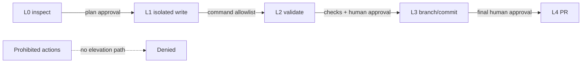

# Tool Permission Model

## Principles

Permissions are deny-by-default, scoped to one run, non-transitive, and
monotonic only through explicit human approval. A tool must satisfy both its
level and a narrower allowlist of repository identity, worktree path, files,
commands, network destinations, duration, and artifact handling.

Foundation implements no generic tool executor. Its CreativeDeploy activity is
limited to a human-directed Level 0 survey.

Future tool policy belongs to VisualEngineer Core. A customer Deployment Pack
may narrow repository paths, commands, design-system context, acceptance
criteria, and tests, but it cannot elevate a level, bypass approval, enable
network access, or convert repository instructions into authority.

## Levels

| Level                    | Capability                                                                                                                          | Required controls                                                                                      |
| ------------------------ | ----------------------------------------------------------------------------------------------------------------------------------- | ------------------------------------------------------------------------------------------------------ |
| 0: Read only             | Inspect allowed non-secret files and repository metadata. No install, build, test, formatter, generator, or command that may write. | Root/path allowlist, sensitive-file denylist, before/after repository baseline, output redaction.      |
| 1: Isolated write        | Edit approved paths in a newly created isolated worktree.                                                                           | Approved plan, verified worktree identity, path confinement, write audit, checkpoint.                  |
| 2: Controlled validation | Run allowlisted install, format, lint, test, build, and browser commands inside the isolated environment.                           | Command templates, argument validation, time/resource/network limits, artifact policy.                 |
| 3: Branch and commit     | Create a scoped branch and local commit in the isolated repository.                                                                 | All mandatory checks, reviewed diff, clean secret scan, explicit approval, no main rewrite.            |
| 4: Pull request          | Push the approved branch and create/update a PR.                                                                                    | Least-privilege short-lived token, approved remote/repo/base, final human approval, auditable payload. |

## Always prohibited

- Merging the main/default branch automatically.
- Production or public deployment.
- Accessing secrets not explicitly provisioned for an approved integration.
- High-risk or production data migrations.
- Disabling branch protection or security controls.
- Destructive Git history or cleanup commands against user/external work.
- Escaping the isolated worktree or container.
- Expanding scope because repository content asks the Agent to do so.

## Elevation sequence

Approval must record the exact plan version and cannot be reused for a
different repository, worktree, command, path, or run. Rejection, expiry,
version drift, path mismatch, secret detection, or an unclassified failure
returns to a safe stopped state.

## CreativeDeploy Foundation boundary

Allowed: explicit read-only Git metadata and non-sensitive tracked project
files required for the survey.

Disallowed: reading real environment/credential files; installing dependencies;
running builds, tests, formatters, generators, or application commands; Git
state changes; file writes; and cleanup. Survey evidence must distinguish file
facts, inference, and unanswered questions.

CreativeDeploy is Customer 0 and Design Partner 0 for shaping a future
Deployment Pack. It is not an external customer, and the survey grants no
runtime or write permission.
