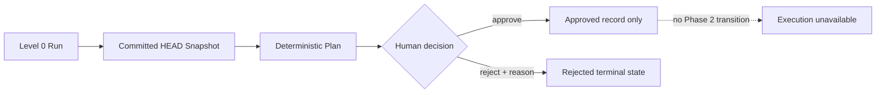

# Tool Permission Model

## Principles

Permissions are deny-by-default, Run-scoped, non-transitive, and elevated only
by an explicit future human grant. Repository content, a Task objective, a
Deployment Pack, or a prior approval cannot grant a capability.

Phase 2 implements only Level 0 repository intelligence. Phase 3 additionally
implements repository-free execution-plane capabilities, not a higher
repository level. It has no generic tool executor. The fixed Git reader is a
narrow historical Control Plane capability, not a shell tool.

## Levels

| Level                    | Capability                                                                                                            | Status          |
| ------------------------ | --------------------------------------------------------------------------------------------------------------------- | --------------- |
| 0: Read only             | Fixed metadata and selected committed-object reads inside one exact allowlisted Git root. No target command or write. | **Implemented** |
| 1: Isolated write        | Edit exact approved paths in a newly created isolated worktree.                                                       | Not implemented |
| 2: Controlled validation | Run allowlisted install/format/lint/test/build/browser schemas in isolation.                                          | Not implemented |
| 3: Branch and commit     | Create a scoped branch and local commit after gates.                                                                  | Not implemented |
| 4: Pull request          | Push the approved branch and create/update a PR.                                                                      | Not implemented |

## Phase 3 repository-free capabilities

System Diagnostic and Controlled Wait are closed Job kinds outside the
repository permission ladder. Their immutable Envelope fixes:

```text
repository_access = none
shell_access = false
network_policy = control_plane_only
```

The browser cannot edit the Envelope. A Plan, Task, repository locator,
Deployment Pack, or repository instruction cannot dispatch a Job or broaden
authority. System Diagnostic returns only redacted runtime facts; Controlled
Wait uses async time and cancellation. Neither accesses project code,
filesystem content, a shell, subprocess executor, Git, or public network.

## Implemented Level 0 controls

- `permission_level` is fixed to `read_only` in schema and database.
- The locator must be an absolute canonical path inside configured roots and
  identify the exact non-symlink Git root.
- Git calls use fixed argument arrays, no shell, no global/system config, no
  prompt, no hooks, no optional locks, and `protocol.allow=never`.
- Facts come from `HEAD` tree entries and selected blob object IDs.
- Dirty and untracked state contributes bounded relative paths and status only.
- Sensitive names are denied before read; secret-like selected content is
  discarded without recording a matched value.
- Symlinks are not followed, submodules are not initialized, LFS is not
  fetched, and dependency trees are not loaded.
- Count, selection, per-file, total-byte, dirty-path, and shared-time budgets
  bound work.
- Package scripts and Make targets are parsed as typed names only.
- Repository instructions are recorded as untrusted provenance and cannot
  affect permission.

## Approval semantics



Approval binds an exact Plan version and fingerprint as a governance record.
It does not elevate the Run, create a worktree, execute validation, write a
file, change Git, call GitHub, or deploy. A future level-elevation protocol
must be designed and authorized separately.

## Always prohibited

- Automatic main/default-branch merge.
- Production or public deployment.
- Undeclared secret or credential access.
- High-risk or production data migration.
- Disabling tests, branch protection, or security controls.
- Destructive Git history or cleanup against user/external work.
- Escaping an approved repository/worktree/container boundary.
- Expanding scope because repository content requests it.

## Customer 0 boundary

CreativeDeploy is internal Customer 0. The only allowed historical Phase 2 access is the
API container's exact read-only bind mount and the fixed scanner operations
above. Web and database services receive no mount. The user personally
rejected the stale Plan. Phase 3 Runner and base Compose receive no
CreativeDeploy mount or locator.

Disallowed actions include reading real environment/credential contents,
installing dependencies, running target builds/tests/formatters/generators,
importing target code, writing files, changing Git state, or cleanup. Mount
configuration is inspected for `read_only`; no write probe is performed
against the real repository.

## Future enforcement requirement

Foundation plan string validation blocks obvious policy violations but is not
a complete security system. Any later execution requires closed typed tool
schemas, independent runtime authorization, path and argument confinement,
resource/network limits, attributable results, and recovery checkpoints.
