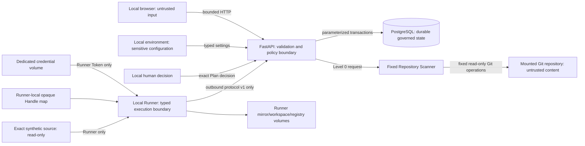

# Security Boundaries

## Phase 6 local Git boundary

Phase 6 adds Git mutation only inside Runner-owned mirror metadata. The API
derives the ref and message; the Runner disables global/system configuration,
credentials, protocols, prompts, hooks, signing, filters, replacements, and
optional locks. It builds an alternate index under the authenticated registry
root, hashes only authorized regular Workspace files, creates one commit with
fixed identity/time, and performs one expected-old-OID ref update.

The operation verifies the exact parent, tree, ref, unchanged Workspace status,
source revision/fingerprint, and dual authority before reporting success.
Source repository bytes and refs are invariants. No remote exists in the
authority or result schema.

The second slice adds no new Git operation. It binds the existing operation to
an immutable server-derived manifest, exact local-user digest confirmation,
keyed `DeliveryDispatch`, linear attempt number, and maximum three-attempt
budget. Runner independently recomputes that manifest immediately before
mutation. Failed/cancelled facts remain durable; retry requires the same
fresh Authorization/manifest and active original implementation Grant.

## Trust zones

The operator is trusted for this local phase. Browser/API fields and all
repository bytes are untrusted. Containers reduce dependency variance but are
not a sandbox for hostile execution.

## API and persistence boundary

- Pydantic validates type, enum, length, blank, NUL, and closed request shapes.
- PostgreSQL checks independently constrain status, permission, source,
  decision, version, and `execution_available`.
- Mutations use explicit transactions, row locks where required, and stable
  idempotency/conflict behavior.
- Delivery dispatch uses an Authorization row lock, unique keyed request hash,
  one-active-attempt index, exact retry lineage, and database triggers that
  reject Job/manifest rebinding or terminal-history mutation.
- Snapshot update/delete is rejected by a PostgreSQL trigger.
- Public errors contain stable codes and sanitized messages, not stack traces,
  connection strings, or repository host paths.
- Audit metadata uses a field allowlist; comments and source text are excluded.
- Governance logs contain request/trace/Run/Snapshot/Plan identifiers,
  duration, event type, and reason code only.

## Repository path boundary

Before Git access, the scanner:

1. rejects blank, NUL, and non-absolute locators;
2. expands user syntax and canonicalizes the path;
3. requires an existing directory;
4. rejects a symlink repository root;
5. requires local non-symlink `.git` metadata;
6. confines the canonical root to `READ_ONLY_REPOSITORY_ROOTS`; and
7. verifies that Git's top-level path exactly equals the locator.

Traversal, a nested non-root path, a network URL, a non-Git directory, a
symlink root, and an out-of-allowlist path fail closed without returning an
unnecessary absolute system path.

## Git and content boundary

Git processes receive fixed argument arrays; no user value is interpreted by a
shell. Global/system config, credential prompts, hooks, optional locks,
filesystem monitor, attributes file, and all protocols are disabled. One
shared monotonic deadline bounds the scan.

Facts come from the verified `HEAD` commit and `ls-tree`. Selected content is
read by blob object ID. The scanner never opens a working-tree file. `status`
provides only bounded relative paths/status, so dirty tracked and untracked
contents cannot influence facts or fingerprint.

Entries are classified before read:

- sensitive filenames are recorded and denied;
- selected secret-like content is discarded without retaining the match;
- known or detected binary content is not parsed;
- lockfiles are metadata-only;
- ignored dependency/build/cache trees are not selected;
- symlink target metadata is size bounded, hashed/classified, and never
  followed;
- gitlinks are recorded without submodule initialization;
- LFS pointers are recorded without fetch; and
- tracked/selected/per-file/total-byte/dirty-path budgets bound outputs.

No package script, lifecycle hook, Make target, test, build, formatter,
generator, Python import, JavaScript load, or repository command is executed.

## Prompt-injection boundary

README, AGENTS, nested instructions, config, comments, and all other repository
text have provenance `untrusted_repository_content`. Detection records a
relative path, committed blob/hash, risk label, and matched rule class. Text
requesting secret access, disabled tests, permission elevation, push, merge,
or deployment has no policy effect.

There is no LLM in Phase 4. This provenance boundary is still enforced and
evaluated so a future model cannot silently inherit repository authority.

## Plan and approval boundary

Plans are deterministic and bound to the Snapshot fingerprint. Revisions can
change only documented review fields. A Foundation policy validator rejects
obvious requests for arbitrary shell, secret access, approval bypass,
permission elevation, automatic merge, production deploy, authentication/
payment modification, or high-risk database migration.

This string policy is intentionally not represented as complete security.
Phase 4 execution uses typed schemas and an independent immutable Execution
Grant; future target commands require another reviewed authority layer.

Only the latest submitted Plan can receive a final decision. PostgreSQL row
locks and uniqueness ensure one concurrent winner. Approval sets a terminal
Phase 2 state and does not execute or authorize code. Phase 4 requires a new
pending Grant and a second local-user approve/reject decision.

The Phase 5 final Review Decision is a third, separate governance record bound
to one immutable latest-success Evidence Package generation. Package
freshness is derived from the exact source revision, Workspace tree and diff,
latest Checkpoint, Suite/Profile identity and version, policy digest, Grant
lineage, aggregate Result, ordered Evidence, and trusted blocker inventory.
Accepted changes to those facts advance a locked freshness scope and append an
invalidation plus ordered AuditEvent in the same PostgreSQL transaction.
The sole trusted Repository Handle revision writer additionally acquires a
transaction-level revision mutex, locks the Handle, and advances affected
scopes before committing its revision/status transition. Immutable source
policy/Evidence rejects in-place replacement. Decision creation requires the
observed generation and persists an independent idempotency key/request hash;
generation and freshness are checked before keyed replay. Decision and
readiness writes acquire the same mutex, lock the Handle, and PostgreSQL
directly compares its trusted revision/status with the frozen Package.
PostgreSQL also recomputes the package, Decision, and readiness digest chain;
`ready` additionally requires Critical, High, and blocking-Medium counts all
equal zero. Review events and records are append-only, and Git/deployment
authorization is independently forced false.

## Runner identity and protocol boundary

- Bootstrap registration uses an ignored high-entropy local token that is
  compared in constant time and never stored in PostgreSQL or shown in Web.
- Registration returns an independent at-least-256-bit Runner Token once.
  PostgreSQL stores only its SHA-256 digest; the non-root Runner stores the
  value mode 0600 in a dedicated volume.
- Bearer authentication selects the Runner identity. Body Runner ID must match;
  revoked, invalid, or mismatched credentials fail with stable 401/403.
- Protocol v1 payloads are strict, closed, limited to 64 KiB, and carry request
  IDs. Full request bodies and authorization headers are never logged.
- Result and event schemas reject unknown fields, secret/path-like values,
  hostname/username/IP/environment/files/package inventory, and excessive
  bytes.

## Permission and lease boundary

The browser submits only a typed action. The Control Plane derives an immutable
Envelope. Repository-free Jobs use repository none. Workspace Jobs use only
`isolated_workspace` and bind an approved immutable Grant, Runner, Handle,
Workspace, exact revision, and policy hash. Shell remains false and transport
is Control-Plane-only; the Grant's target network is none. PostgreSQL rejects
policy mutation; API and Runner revalidate status, expiry, hashes, bindings,
capability, and authority throughout the Lease.

Claim uses `FOR UPDATE SKIP LOCKED`; a partial unique index permits one active
Attempt. Every mutation verifies authenticated Runner, active Attempt, Lease
UUID, deadline, and legal state under lock. Stale identity returns
`409 stale_lease`. Cancellation blocks later success. The advisory-locked
reaper expires/requeues or fails attempts within a finite retry budget.

## Runner container boundary

Runner is non-root with read-only root filesystem, all capabilities dropped,
no-new-privileges, tmpfs `/tmp`, no published port, and dedicated credential,
mirror, workspace, and registry volumes. It joins only the internal
`runner-control` network shared with API. The Phase 4 override adds one exact
synthetic source bind as read-only. It has no default/database/Web network,
customer/developer-parent mount, CreativeDeploy, Docker socket, SSH material,
or public-network path.

System Diagnostic and Controlled Wait remain in-process. Workspace tools are
closed filesystem operations, and `git_ops.py` is the sole fixed Git subprocess
boundary. There is no arbitrary command, shell, target build/test/browser
command, dynamic plugin, package lifecycle, or Git delivery operation.

## Workspace filesystem boundary

- The Control Plane stores an opaque handle, never a Runner host path.
- Mirror population copies only committed objects for the exact approved
  revision; dirty/untracked content, hooks, submodule worktrees, and LFS
  objects are excluded.
- Relative POSIX paths are bounded and resolved by descriptor-relative
  no-follow directory walks, not string authority.
- `.git`, sensitive classes, symlinks, hard links, non-regular files, binary,
  invalid UTF-8, oversized content, and budget overflow fail closed.
- Create/replace use exclusive mode-0600 same-directory temp files, fsync,
  atomic link/rename, inode/hash revalidation, and deterministic crash retry.
- Rollback removes only ledger-owned created files and requires the initial
  tree fingerprint; discard resolves a Workspace UUID and validates registry
  plus root device/inode.

Python lacks portable `openat2`/`renameat2` pathname-CAS interfaces. The
deployed local design therefore makes Runner the only workspace-volume writer
and uses conservative conflict checks; it is not a hostile same-UID writer or
multi-tenant sandbox guarantee. See the
[Workspace threat model](workspace-threat-model.md).

## Customer 0 mount boundary

The optional Compose override:

- receives the host path through an uncommitted environment variable;
- mounts only CreativeDeploy, only into the API;
- uses stable container path `/repositories/customer0/creative-deploy`;
- sets that exact path as the only repository root;
- marks the bind mount read-only;
- gives no mount to Web or PostgreSQL;
- uses no Docker socket or privileged mode; and
- runs the API as non-root.

The real repository is verified through mount inspection and before/after
read-only Git observations. A write probe is not performed against
CreativeDeploy.

This override is historical Phase 2 evidence. Phase 3 base Compose and the
Phase 4 fixture Runner do not use it.

## Network and public-exposure boundary

The scanner has no authorized repository network access. The application needs
no OpenAI, GitHub, Figma, cloud, or production credential. The local services
have no authentication, authorization, tenancy, rate limiting, CSRF/session
model, or public hardening and must not be exposed to a shared or public
network.

## Evidence boundary

Adversarial fixtures contain synthetic markers only. Passing local tests and
Compose checks prove the declared local Phase 4 behavior, not production
security certification. CreativeDeploy is internal Customer 0, not external
enterprise adoption or outcome evidence.

Local bearer credentials, Docker internal networking, and containers are not
production identity, egress policy, or hostile-code sandboxing. See the
[Runner threat model](runner-threat-model.md) for residual risks and upgrades.
