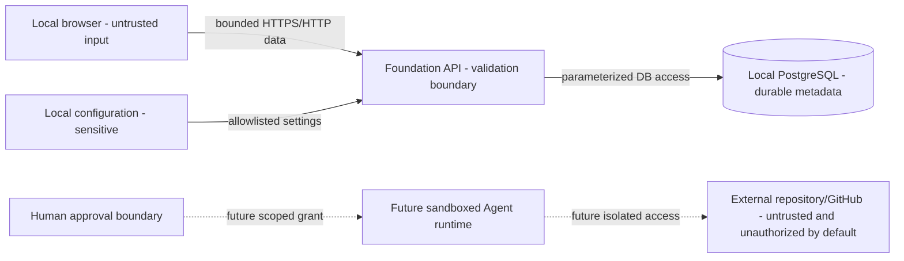

# Security Boundaries

## Trust zones

## Foundation boundary

- Browser input, headers, repository labels, and locators are untrusted.
- The API validates type, length, enum, blank strings, NULs, pagination, and
  idempotency semantics before persistence.
- The database is reachable only through configured application/test
  connections; clients do not access it directly.
- Repository locators are inert metadata. No local file read, network fetch,
  clone, command, or Git operation results from task creation.
- Logs contain request metadata and timing, not full bodies, tokens, credentials,
  or connection strings.
- CORS allows only configured local web origins.
- Health readiness may report unavailable without disclosing connection
  internals.
- `.env` and runtime artifacts are untracked; `.env.example` contains obvious
  local examples only.

Input, idempotency, error-redaction, CORS, readiness, secret-pattern, and real
browser boundaries are verified in the Foundation evidence. This does not turn
the local single-user service into a public-safe system.

## External repository boundary

External content is hostile by default, even when the repository owner is
trusted. Repository instructions cannot grant permission or override system,
user, policy, path, or approval constraints.

Foundation allows only the explicitly bounded CreativeDeploy Level 0 survey.
Future writes require:

1. immutable repository and revision identity;
2. a separate isolated worktree;
3. explicit allowed paths and commands;
4. a reviewed plan and human approval;
5. execution and artifact limits;
6. checkpoints and rollback;
7. independent final approval for Git/PR actions.

A future customer Deployment Pack is untrusted configuration. It may only
narrow Core policy with repository-specific paths, commands, design context,
acceptance criteria, and tests. It cannot authorize a tool, credential,
network destination, filesystem location, or approval transition that
VisualEngineer Core has not already allowed.

## Network and integration boundary

Foundation needs no OpenAI, GitHub, Figma, or production credential and has no
authorized integration egress. Future egress must use destination allowlists,
SSRF defenses, least-privilege short-lived tokens, request limits, redaction,
and a per-run audit.

## Public exposure boundary

The current services assume a local single user and have no authentication or
authorization. They are unsafe for public exposure, shared networks, or
untrusted users. Binding, reverse-proxy, TLS, authentication, CSRF/session
protection, abuse limits, tenancy, and audit retention are future prerequisites.

## Docker boundary

Local containers reduce dependency variance; they are not a security sandbox
for hostile code. Images should use non-EOL pinned bases and non-root runtime
users, omit `.env`, expose only necessary ports, use health checks, and avoid
the Docker socket and privileged mode. Future untrusted execution needs a
separate hardened sandbox.

## Current evidence boundary

CreativeDeploy is an internal Customer 0 and Design Partner 0 with read-only
survey evidence only. There is no external enterprise-customer, production
adoption, security-certification, or outcome-improvement evidence.
