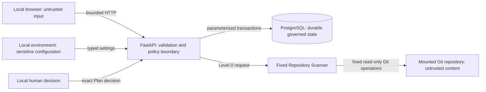

# Security Boundaries

## Trust zones

The operator is trusted for this local phase. Browser/API fields and all
repository bytes are untrusted. Containers reduce dependency variance but are
not a sandbox for hostile execution.

## API and persistence boundary

- Pydantic validates type, enum, length, blank, NUL, and closed request shapes.
- PostgreSQL checks independently constrain status, permission, source,
  decision, version, and `execution_available`.
- Mutations use explicit transactions, row locks where required, and stable
  idempotency/conflict behavior.
- Snapshot update/delete is rejected by a PostgreSQL trigger.
- Public errors contain stable codes and sanitized messages, not stack traces,
  connection strings, or repository host paths.
- Audit metadata uses a field allowlist; comments and source text are excluded.
- Governance logs contain request/trace/Run/Snapshot/Plan identifiers,
  duration, event type, and reason code only.

## Repository path boundary

Before Git access, the scanner:

1. rejects blank, NUL, and non-absolute locators;
2. expands user syntax and canonicalizes the path;
3. requires an existing directory;
4. rejects a symlink repository root;
5. requires local non-symlink `.git` metadata;
6. confines the canonical root to `READ_ONLY_REPOSITORY_ROOTS`; and
7. verifies that Git's top-level path exactly equals the locator.

Traversal, a nested non-root path, a network URL, a non-Git directory, a
symlink root, and an out-of-allowlist path fail closed without returning an
unnecessary absolute system path.

## Git and content boundary

Git processes receive fixed argument arrays; no user value is interpreted by a
shell. Global/system config, credential prompts, hooks, optional locks,
filesystem monitor, attributes file, and all protocols are disabled. One
shared monotonic deadline bounds the scan.

Facts come from the verified `HEAD` commit and `ls-tree`. Selected content is
read by blob object ID. The scanner never opens a working-tree file. `status`
provides only bounded relative paths/status, so dirty tracked and untracked
contents cannot influence facts or fingerprint.

Entries are classified before read:

- sensitive filenames are recorded and denied;
- selected secret-like content is discarded without retaining the match;
- known or detected binary content is not parsed;
- lockfiles are metadata-only;
- ignored dependency/build/cache trees are not selected;
- symlink target metadata is size bounded, hashed/classified, and never
  followed;
- gitlinks are recorded without submodule initialization;
- LFS pointers are recorded without fetch; and
- tracked/selected/per-file/total-byte/dirty-path budgets bound outputs.

No package script, lifecycle hook, Make target, test, build, formatter,
generator, Python import, JavaScript load, or repository command is executed.

## Prompt-injection boundary

README, AGENTS, nested instructions, config, comments, and all other repository
text have provenance `untrusted_repository_content`. Detection records a
relative path, committed blob/hash, risk label, and matched rule class. Text
requesting secret access, disabled tests, permission elevation, push, merge,
or deployment has no policy effect.

There is no LLM in Phase 2. This provenance boundary is still enforced and
evaluated so a future model cannot silently inherit repository authority.

## Plan and approval boundary

Plans are deterministic and bound to the Snapshot fingerprint. Revisions can
change only documented review fields. A Foundation policy validator rejects
obvious requests for arbitrary shell, secret access, approval bypass,
permission elevation, automatic merge, production deploy, authentication/
payment modification, or high-risk database migration.

This string policy is intentionally not represented as complete security.
Future execution requires typed tool schemas and an independent runtime policy
engine.

Only the latest submitted Plan can receive a final decision. PostgreSQL row
locks and uniqueness ensure one concurrent winner. Approval sets a terminal
Phase 2 state and does not execute or authorize code.

## Customer 0 mount boundary

The optional Compose override:

- receives the host path through an uncommitted environment variable;
- mounts only CreativeDeploy, only into the API;
- uses stable container path `/repositories/customer0/creative-deploy`;
- sets that exact path as the only repository root;
- marks the bind mount read-only;
- gives no mount to Web or PostgreSQL;
- uses no Docker socket or privileged mode; and
- runs the API as non-root.

The real repository is verified through mount inspection and before/after
read-only Git observations. A write probe is not performed against
CreativeDeploy.

## Network and public-exposure boundary

The scanner has no authorized repository network access. The application needs
no OpenAI, GitHub, Figma, cloud, or production credential. The local services
have no authentication, authorization, tenancy, rate limiting, CSRF/session
model, or public hardening and must not be exposed to a shared or public
network.

## Evidence boundary

Adversarial fixtures contain synthetic markers only. Passing local tests and
Compose checks proves the declared local Phase 2 behavior, not production
security certification. CreativeDeploy is internal Customer 0, not external
enterprise adoption or outcome evidence.
